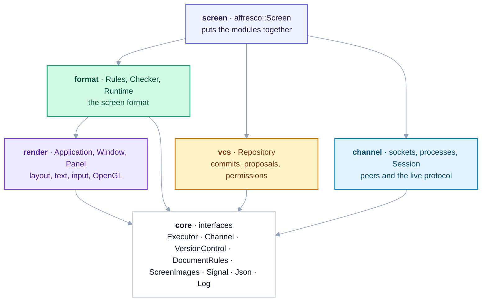
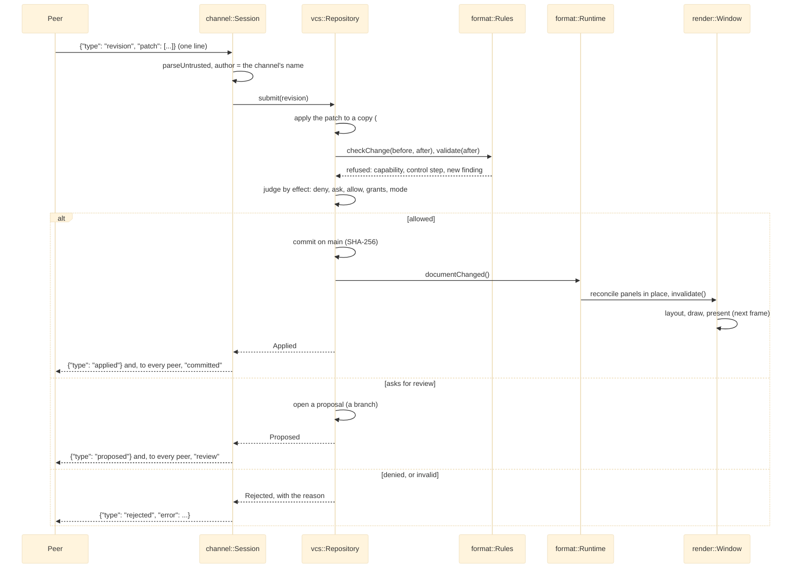
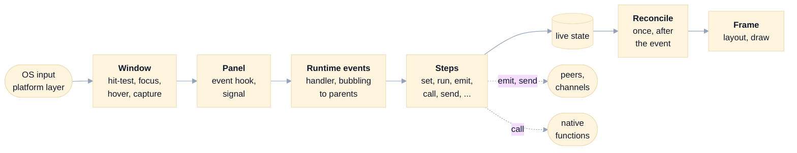

# Architecture

AffrescoUI renders what it is told to. An application is a JSON screen document (`SCREEN_FORMAT.md`) plus whatever
native code the application registers; people and agents change the document while it runs, and version control
(`VERSION_CONTROL.md`) decides which changes land. The library is general: it offers building blocks and extension
points for large apps such as IDEs and creative tools, and anything only one application needs lives in that
application (the templates and `examples/`).

This page is the map: the layers, the path of a revision and of an event, where capabilities are checked, and how the
library is extended. Each module's `README.md` has the details: its headers, invariants, threads, errors, files and
recipes.

## The layers

Six modules, one CMake target each. They depend on each other only as the arrows show, and anything else crossing a
module boundary goes through an interface in `core`.

| Module | Target | Role | Implements | Uses |
|---|---|---|---|---|
| [`core`](modules/core/README.md) | `affrescoui::core` | The interfaces between modules (headers only) | | |
| [`render`](modules/render/README.md) | `affrescoui::render` | Windows, the panel tree, layout, text, input, OpenGL | `Executor` (`Application`) | |
| [`format`](modules/format/README.md) | `affrescoui::format` | The screen format: validation, the checker, expressions, the runtime | `DocumentRules` (`Rules`), `VersionObserver` (the runtime) | `VersionControl`, `render` |
| [`vcs`](modules/vcs/README.md) | `affrescoui::vcs` | Version control of any JSON document | `VersionControl` (`Repository`) | `DocumentRules` |
| [`channel`](modules/channel/README.md) | `affrescoui::channel` | Transports and the live protocol | `Channel` | `Executor`, `VersionControl`, `ScreenImages` |
| [`screen`](modules/screen/README.md) | `affrescoui::affrescoui` | The composition root, `affresco::Screen` | `ScreenImages` | every module |

Outside the library: `examples/` (the host, the Studio, an application type), `mcp/` (an MCP server that is a peer
like any other), and `tests/` (`unit`, `render`, `fuzz`, `perf`, `package`).

Rules that hold across the layers:
- **No public header exposes OpenGL or GLFW.** Every OpenGL call is in `modules/render/src/gl/`, and every GLFW call
  in `modules/render/src/platform/GlfwPlatform.cpp`: `Window` and `Application` reach them through the platform
  layer and the renderer interface, so a window's logic also runs headless, without either.
- **One thread runs the UI.** Everything runs on the main thread, inside `Application::run`. Threads that read sockets
  or child processes only `post` what they read to the `Executor`. Each class documents the thread that owns it.
- **Owners are explicit.** `std::unique_ptr` owns; references and raw pointers never do, and each says how long it
  must live ("must outlive the session"). Callbacks that capture `this` are cancelled when their owner goes away.
- **Errors name the place.** Document errors are `DocumentError`s like `root.children[1].anchors: unknown edge
  'lefft'`; refused changes come back as results with a reason, never as a crash.

## The path of a revision

A revision is a change to the document or its live state, written as compact edits or JSON Patch, from a peer (the
Studio, an agent through `mcp/`, any socket client), from a `patch` step, or from the application (`Screen::commit`).
This is the path of one from a peer:

- **Atomic.** The patch is applied to a copy; if any operation, the format's checks or the build fails, nothing
  changes. If the runtime can't build a version that version control accepted, it refuses it and version control
  rolls it back.
- **Judged by effect.** Permission rules look at what changed between the document before and after, not at the
  paths the patch used. Deny beats ask beats allow, and what no rule allows asks.
- **Reviewed as seen.** A reviewer accepts a proposal by naming the head they saw; if the branch moved since, the
  approval is refused. An author never approves its own change. `preview` shows a proposal live before anyone
  decides; while it is previewed, control steps run only from the user's own input.
- **Stored as RFC 6902.** Compact edits are normalised to JSON Patch before they are committed, and the history can
  be kept on disk (`vcs`, `openHistory`), verified by hash when it is loaded.

## The path of an event

Input reaches the panels through the window, and the screen's handlers turn it into steps:

1. `Window` receives the OS event (from the platform layer, or from a test calling its `route...` methods on a
   headless window), finds the panel (the deepest shown panel under the pointer, the focused panel for
   keys, or the panel holding the mouse during a drag) and calls its event hook, which fires its signal.
2. The runtime connected to those signals when it built the panel. It looks for the handler (`onClick`, `onKey`,
   ...) on the panel, then on its parents for events that bubble, and runs its steps with the event as `event`.
3. Steps change the live state, run actions, start timers and animations, emit events to peers, send to channels or
   call native functions. Expressions in them read the state and never change it.
4. Every state change during the event is batched: after the event has been delivered (`Window::defer`), the runtime
   reconciles the panels once and the window draws one frame.

Timers (`every`, `after`, `debounce`, animations) and channel messages (`<channel>:<type>` actions) enter at step 3
the same way, on the main thread.

## The capability boundary

Some things reach outside the document: talking to programs, writing to disk, deciding on proposals, running native
code. The **host grants them, and a revision never widens them.**

| Capability | Granted by | Guarded by |
|---|---|---|
| Connecting to programs | the screen file's `channels`; `Screen::listen` and `connect` in the host | `channels` can't be changed by a revision |
| Writing state to disk | the screen file's `persist`; the data folder | `persist` can't be changed by a revision |
| Who may change what, and who reviews | the screen file's `permissions`; the host's mode | `permissions` can't be changed by a revision; `deny` holds even in `acceptEdits` |
| Native code | the application's `onCall`, `onAction` and `registerType` | a revision can't add, change or move a `call`, `send`, `connect` or `patch` step, nor a way to run one |
| Deciding on proposals, history | review steps in the screen file; reviewer peers | a revision can't add review or history steps (`accept`, `reject`, `preview`, `restore`, `revert`, `undo`, ...); an author can't approve itself |
| Peers | a socket only this user may open | each peer is authored by the name it was connected as |

All of it is enforced in one place for revisions, `format::Rules::checkChange`, called by version control on every
change, so a new capability is safe once it is checked there. `SECURITY.md` has the threat model, the limits on
untrusted input, and the known gaps.

## Registries and extension points

Today an application extends the library at these points:
- **Node types:** `Screen::registerType(name, factory, properties, apply)`, through the same type registry as the
  built-in types (a name the format has replaces that type). The type gets the properties of the built-in widget its
  panel derives from, plus its own (`examples/CodeEditor.*` adds a `code` type with syntax colours).
- **Native behaviour:** `onAction` and `onCall`, and listeners on `onEvent`.
- **Widgets:** `Panel` subclasses (`paint`, `prepareLayout`, `arrange`, the event hooks); `TextEditor`'s colouring hook.
- **Transports and backends:** a `Channel`, a `VersionControl` or a `DocumentRules` of your own (`core`).
- **The log:** `setLogSink`.

Inside the library, the format grows by registration (7.12): node types (`TypeRegistry`), steps
(`StepRegistry`) and document sections (`SectionRegistry`) register from their own files, so a new widget, step
group or section is a new file (`modules/format/README.md` has the recipes). The runtime itself is a composition
root, `format::Engine`, with eight subsystems: document context, builder, reconciler, properties, events, steps,
scheduler and catalog. The catalog agents read is built from the registries.

A window's logic runs without a display (7.3): the platform layer (`platform::Platform`, `NativeWindow`) and the
renderer (`detail::Renderer`) are internal interfaces, and a window built without them is headless. Every window
reads one `Clock`; the tests use a headless window and a manual clock (`modules/render/src/Headless.hpp`, internal
for now).

Expressions are lowered once into typed nodes and run on small values that read the state in place (7.5,
`modules/format/README.md`). A history keeps each commit as a delta from its parent, with a snapshot every 64
commits, and packs its files on disk (4.8a, `modules/vcs/README.md`).

Text is shaped with HarfBuzz and rasterised with FreeType (2.3b, `modules/render/README.md`): runs of one face and
one script, each character from the first font of a `fonts` fallback list that has it, colour emoji on colour atlas
pages in the same batch as the text, and shaped text cached by line and by word. A screen's fonts live in a bounded
`FontCache`, which drops the least recently used fonts nothing holds.

## The build

The root `CMakeLists.txt` holds the options, the pinned dependencies (GLFW, nlohmann/json, and FreeType and HarfBuzz
in `cmake/AffrescoUIText.cmake`; doctest for the tests),
the warnings and `affrescoui_module()`, and adds the modules in dependency order. Each module lists its own sources
in `modules/<name>/CMakeLists.txt`. The unit tests and the window tests are found by a glob (`tests/unit/*.cpp`,
`tests/unit/window/*.cpp`), and the rendering check reads every `tests/render/scenarios/*.json`, so a new test file
or scenario file needs no edit to a shared list. `cmake/AffrescoUIInstall.cmake` installs the libraries and the
`find_package(AffrescoUI)` package. The API reference is built with Doxygen (`doxygen Doxyfile`, into
`build/api-reference/`).
