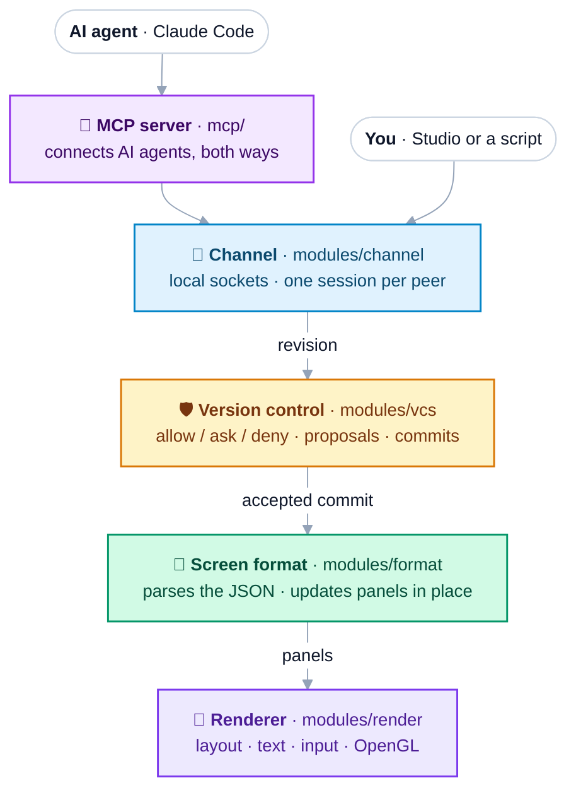
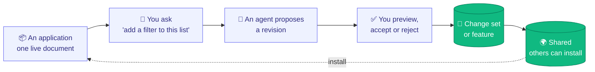
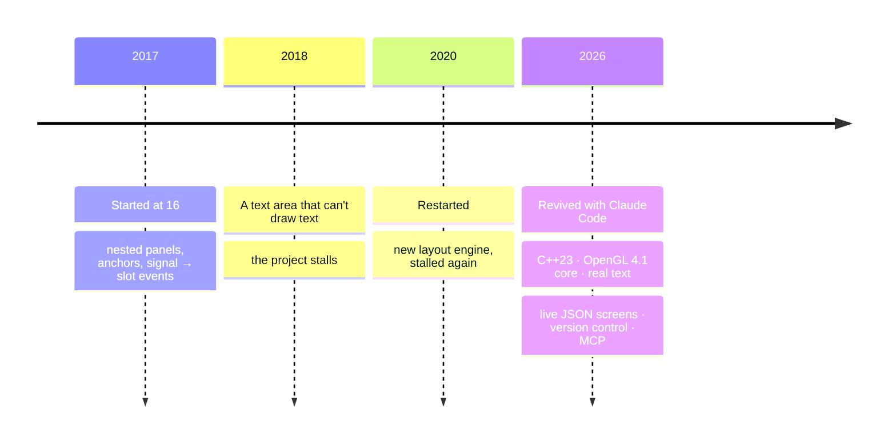

<div align="center">

# AffrescoUI

### One format for every application, rendered natively.<br/>Built with AI by anyone. Changed by its users while it runs.

[](#use-it-in-your-app)
[](#architecture)
[](mcp/README.md)
[](#native-performance)
[](LICENSE)

**[Vision](#the-vision)** · **[Applications](#applications)** · **[Architecture](#architecture)** ·
**[Quick start](#quick-start)** · **[How it works](#how-it-works)** ·
**[Screen format](SCREEN_FORMAT.md)** · **[Version control](VERSION_CONTROL.md)** · **[MCP server](mcp/README.md)**

<br/>


<sub>Flow, a Kanban board drawn by a native C++ / OpenGL engine. Its whole interface is one live JSON document, and the
round button in the corner opens a chat: ask for a change in plain words, an AI agent proposes it, and you review it
before it lands.</sub>

</div>

---

Today an application is code: written for one toolkit, built, shipped, and frozen until the next release. When an AI
changes it, it edits that code, and someone rebuilds and redeploys it. **AffrescoUI works differently.** An application
is a **live document in one unified format**: its layout, state and behaviour, in readable JSON. A small native engine
renders whatever the document describes, from a sign-in form to an IDE, an image editor or a 3D modeller, and keeps it
running. People, scripts and AI agents change it by sending **revisions**. The engine checks each one against the
app's permissions, can show it as a **live preview**, and applies it **in place in milliseconds**. The app never
stops, and your typing, focus and drags survive.

## The vision

Software has always been frozen at build time: its features are whatever its developers shipped. AffrescoUI
applications are **dynamic**: they stay malleable while they run, and the people who use them direct how they grow.

- **One format, rendered simply.** Every application, however complex, is described the same way: nodes, state,
  expressions, events, services and permissions, in one document format ([SCREEN_FORMAT.md](SCREEN_FORMAT.md)). The
  engine is agnostic. It renders what it is told to, so the same small engine draws a Kanban board, a planetarium and
  a 3D modeller, and a feature written for one application can be installed in another.
- **Complex applications, built by everyone with AI.** An application is a document, not a code base, so building one
  is a conversation: describe what you want, and an agent writes and refines it. The format is rich enough for
  workbenches, editors and creative tools, and compact enough that each change costs an agent few tokens. You don't
  need to be a programmer to build one.
- **The end user updates the end application.** The people who use an application can change it, not only the people
  who built it. Ask the app itself through its chat (*"add a Blocked column"*, *"dim the lights at sunset"*, *"warn me
  when a habit streak breaks"*) and an agent turns the request into a revision. You see it live, then accept or undo
  it. Nothing changes without your approval, and every change is versioned.
- **Prototype while it runs.** There is no edit, rebuild and restart loop. Every change lands in the running
  application in milliseconds, without stopping or reloading it, and its state stays where it was. When the prototype
  is right, it is already the native app: embed the same document in C++ in a few lines.

Behaviour that would usually need code (wiring a button to a list, validating a form, filtering on a search,
drag and drop, timers, shortcuts, navigation, calls to services) is part of the document, so an agent can change it as
safely as a colour.

## Applications

Twelve applications, from everyday apps to professional tools, each one written in the same format and changed live
by people and agents. They live in [`examples/`](examples/README.md) and are not part of the library: they show what
anyone can build with it. Every one carries the **assistant** in its bottom right corner, a chat with the connected
agents where you ask for a change in plain words and review the proposal it becomes
([the add-on](examples/shared/addons/assistant/README.md), one line to `include` in any screen).

### Professional tools

<table>
<tr>
<td width="50%" valign="top"><br/><b>Forge</b> · an IDE workbench<br/><sub>A full code workbench: an explorer, editor tabs with syntax colouring, search across files, source control with diffs, an integrated terminal, language servers, a debugger, a command palette, and dark, light and high-contrast themes. Its whole interface is one screen document. <code>./build/affrescoui_forge [folder]</code></sub></td>
<td width="50%" valign="top"><br/><b>Tempera</b> · an image editor<br/><sub>Layers and groups, masks and selections, brushes, filters with a live preview, adjustment layers and colour management, on sparse copy-on-write tiles. Agents can only propose changes here: the person reviews every one. <code>./build/affrescoui_tempera</code></sub></td>
</tr>
<tr>
<td valign="top"><br/><b>Sinopia</b> · slides and vector documents<br/><sub>Slide decks and vector pages with a ribbon, slide thumbnails, a canvas editor, a slide sorter, presenting with an audience window, and PDF export. Its slide sorter is a reusable part that other applications install. <code>./build/affrescoui_sinopia</code></sub></td>
<td valign="top"><br/><b>Modello</b> · a 3D modeller<br/><sub>A lit 3D viewport with gizmos and a navigation widget, an outliner, a properties editor, a timeline, search over every command, and glTF import and export. Every scene edit is a revision, so it can be reviewed and undone. No C++ of its own. <code>examples/modello/modello.screen.json</code></sub></td>
</tr>
<tr>
<td valign="top"><br/><b>Quaderno</b> · a code editor<br/><sub>A side bar with open files and folders, tabs, a minimap, Goto Anything over files, symbols and lines, Find in Files with a results buffer, a command palette and a console. <code>examples/code-editor/code-editor.screen.json</code></sub></td>
<td valign="top"><br/><b>Orrery</b> · a planetarium<br/><sub>A 3D solar system, the sky seen from the ground, a graph of what orbits what, a timeline of eclipses and conjunctions, and a bodies strip that is Sinopia's slide sorter, installed from that app. Built by an outsider from the public docs alone. <code>examples/orrery/orrery.screen.json</code></sub></td>
</tr>
</table>

### Everyday apps

<table>
<tr>
<td width="50%" valign="top"><br/><b>Haven</b> · a smart-home dashboard<br/><sub>Rooms in a tree by floor, a floor plan, scenes, lights with their colours, climate, blinds and media, automations as a node graph with schedules on a timeline, an energy page with charts, security and notifications. <code>examples/haven/smart-home.screen.json</code></sub></td>
<td width="50%" valign="top"><br/><b>Tempo</b> · a music player<br/><sub>Playlists, a 3,000-song library in a virtualised table, albums and artists in grids, search, a queue to reorder, now playing with a visualiser and lyrics, an equaliser, crossfade and a mini player. <code>examples/tempo/music-player.screen.json</code></sub></td>
</tr>
<tr>
<td valign="top"><br/><b>Streak</b> · a habit tracker<br/><sub>Habits to check day by day, with schedules and goals, scores, charts, a year heatmap, a calendar, notes and reminders, all kept on disk. <code>examples/streak/habit-tracker.screen.json</code></sub></td>
<td valign="top"><br/><b>Arcadia</b> · a game launcher<br/><sub>A library and a store with carousels, game pages, downloads, a wishlist and a cart, with key chords and a quick switcher. Built only from the public docs and tools. <code>examples/arcadia/game-launcher.screen.json</code></sub></td>
</tr>
<tr>
<td valign="top"><br/><b>Flow</b> · a Kanban board<br/><sub>Boards as tabs, swimlanes, a table and a timeline of every card, a card drawer, a burndown and an activity feed, drag and drop with a keyboard alternative, undo and a command palette. What the host opens by default. <code>examples/flow/kanban.screen.json</code></sub></td>
<td valign="top"><br/><b>Sign in</b> · accounts<br/><sub>Sign in, create an account, two-step codes, a password reset, sign-in with an external provider, an account page and a session that expires, all validated in the document. <code>examples/sign-in/sign-in.screen.json</code></sub></td>
</tr>
</table>

Run any of them with `./build/affrescoui_host <file>` (Forge, Tempera and Sinopia have their own programs, for the
few natives a document can't hold: files, a terminal, pixels). Flow, Haven, Tempo, Streak, Arcadia and Sign in ship in
English, Spanish and French. Ideas for an agent to try: *"add a Blocked column"*, *"a Movie night scene that dims every light"*, *"show the album
name under the track title"*, *"a dark theme for the habit tracker"*.

## Architecture

A stack of layers, each with one job, each handing its result to the one below. The four C++ layers are separate
libraries; the MCP server on top is a small Python program.



The layers talk to each other only through small interfaces in `modules/core`, so any of them can be swapped (another
transport, another version-control backend, another document format). `affresco::Screen` (`modules/screen`) plugs
them together. No public header exposes OpenGL or GLFW, and each layer can be linked on its own
(`affrescoui::render`, `affrescoui::vcs`, ...) or all together through `affrescoui::affrescoui`.

```
modules/render/    the renderer: panels, layout, text, input, batched OpenGL (all GL code in src/gl)
modules/format/    the JSON screen format: validation and permission rules, {{expressions}}, Runtime
modules/vcs/       version control: Repository
modules/channel/   transports and the live protocol Session
modules/core/      the interfaces between layers: Executor, Channel, VersionControl, DocumentRules
modules/screen/    affresco::Screen, the composition root, and the umbrella header affresco/affresco.hpp
mcp/               the Python MCP server
schema/            JSON Schema of the screen format
examples/          the applications, affrescoui_host, affrescoui_studio, the assistant add-on, fonts
external/          vendored glad (OpenGL loader) and stb_truetype
```

## Why it's different

<table>
<tr>
<td width="33%" valign="top">

### 🎨 Truly native
A from-scratch **C++23 / OpenGL** engine. No browser, no web view, a **~1 MB** app binary. A whole frame is
**one draw call** per font, and an idle app uses **0% CPU**.

</td>
<td width="33%" valign="top">

### 📄 Live documents
A whole app in readable JSON: layout, components, state, JS-style `{{expressions}}`, events, timers, screens.
Changes are **compact edits** by node id, atomic, and reconciled **in place**.

</td>
<td width="33%" valign="top">

### 🛡️ Version control built in
**Git's model with Claude Code's approvals:** content-addressed commits, proposals as branches with **live
preview**, merge, revert and diff; `allow` / `ask` / `deny` rules, modes and *"don't ask again"*.
An AI can change your app but **can never approve its own changes**.

</td>
</tr>
<tr>
<td valign="top">

### 🤖 Agent-ready
A **two-way MCP server**: requests from your client reach the agent, and the agent's revisions and replies come back.
Works with Claude Code out of the box.

</td>
<td valign="top">

### 🔌 Any number of peers
Clients, agents and scripts connect over local sockets. The engine doesn't care what they are, only **who they
are**, and a peer's identity is set by the socket it connects to.

</td>
<td valign="top">

### 🧩 Changes become plugins
Export any run of revisions as a **change set**: a small, portable file that anyone with the same application
can review and install.

</td>
</tr>
</table>

## How it works

```mermaid
%%{init: {"theme": "base", "flowchart": {"curve": "basis", "nodeSpacing": 28, "rankSpacing": 46, "padding": 14}, "themeVariables": {"fontFamily": "Helvetica, Arial, sans-serif", "fontSize": "14px", "lineColor": "#94A3B8", "primaryTextColor": "#0F172A", "edgeLabelBackground": "#FFFFFF"}}}%%
flowchart LR
    subgraph P["Who changes it"]
        direction TB
        you["<b>You</b><br/>AffrescoUI Studio"]
        ai["<b>AI agent</b><br/>Claude Code · MCP"]
        any["<b>Scripts & apps</b><br/>any socket client"]
    end

    subgraph V["Version control"]
        direction TB
        rules{"<b>Permission rules</b><br/>deny · ask · allow"}
        pr["<b>Proposal</b><br/>branch · live preview"]
        no["<b>Rejected</b><br/>nothing changes"]
    end

    subgraph E["Engine"]
        direction TB
        main[("<b>main</b><br/>SHA-256 commits")]
        rt["<b>Runtime</b><br/>reconcile in place"]
        gl["<b>Renderer</b><br/>C++23 · OpenGL"]
    end

    app(["<b>Your running app</b><br/>never restarts"])

    you & ai & any -- "revision" --> rules
    rules -- "allow" --> main
    rules -- "ask" --> pr
    rules -- "deny" --> no
    pr -- "you accept" --> main
    main --> rt --> gl --> app

    classDef peer fill:#FFFFFF,stroke:#CBD5E1,stroke-width:1px,color:#0F172A
    classDef gate fill:#FFFBEB,stroke:#D97706,stroke-width:1.5px,color:#78350F
    classDef wait fill:#FFFFFF,stroke:#D97706,stroke-width:1px,stroke-dasharray:4 3,color:#78350F
    classDef stop fill:#FFFFFF,stroke:#E11D48,stroke-width:1px,color:#9F1239
    classDef core fill:#EEF2FF,stroke:#6366F1,stroke-width:1.5px,color:#1E1B4B
    classDef out fill:#0F172A,stroke:#0F172A,color:#FFFFFF
    class you,ai,any peer
    class rules gate
    class pr wait
    class no stop
    class main,rt,gl core
    class app out
    style P fill:#F8FAFC,stroke:#E2E8F0,color:#64748B
    style V fill:#F8FAFC,stroke:#E2E8F0,color:#64748B
    style E fill:#F8FAFC,stroke:#E2E8F0,color:#64748B
    linkStyle 0,1,2 stroke:#94A3B8
    linkStyle 3 stroke:#16A34A,stroke-width:2px
    linkStyle 4 stroke:#D97706,stroke-width:1.5px
    linkStyle 5 stroke:#E11D48,stroke-width:1.5px
    linkStyle 6 stroke:#16A34A,stroke-width:2px
    linkStyle 7,8,9 stroke:#6366F1,stroke-width:2px
```



1. **Anyone can propose a change.** The app (`affrescoui_host`) only renders a screen, here the *Flow* Kanban board,
   and listens for peers on local sockets. You use the **assistant** inside the app, or the **AffrescoUI Studio**
   beside it. An AI agent connects through the MCP server, which works both ways: your requests are pushed into its
   session, and its replies come back to you. Any script can connect too. Every change is a **revision**: compact
   edits like `{"set": {"#title/text": "Q4"}}`, stored as JSON Patch.
2. **The permission rules decide**, written like Claude Code's: `deny` refuses, `ask` sends the change to you, `allow`
   applies it. Rules judge what a change *does*, not how its patch is written. The applications let the Studio change
   anything, always ask before the agent changes behaviour, and protect the status bar.
3. **You review proposals.** A proposal is a branch, like a pull request: the agent can keep refining it while you
   preview it live in the app. Then **Accept**, **Always allow** (don't ask again for that part of the screen) or
   **Reject** with a reason. Switch the mode to *accept edits* or *plan* at any time.
4. **Accepted changes become commits on `main`**, with SHA-256 ids and both the author and the approver recorded. The
   runtime updates the running app in place: no restart, and focus and typing are kept. Any commit can be reverted
   or restored. See [VERSION_CONTROL.md](VERSION_CONTROL.md).

<p align="center">
<br/>
<sub>The <b>AffrescoUI Studio</b>, a client that is itself an AffrescoUI screen (layout, behaviour and its connection, no C++): ask the AI, edit directly, then review each proposal on the Review tab, browse the History table (revert, restore) and set the mode and grants on Rules. Dark by default, Cmd+J for light.</sub>
</p>

## Quick start

```sh
cmake -S . -B build && cmake --build build

./build/affrescoui_host                  # Flow, the Kanban board, listening in /tmp/affrescoui-<uid>
./build/affrescoui_studio                # the client: apply patches, review, ask the AI
```

Then connect an AI agent through MCP ([mcp/README.md](mcp/README.md)):

```sh
claude mcp add affrescoui -- python3 /path/to/AffrescoUI/mcp/affrescoui_mcp.py
claude --dangerously-load-development-channels server:affrescoui   # requests are pushed into the session
```

Type *"add a Blocked column between In progress and Review"* in the board's assistant (the round button in the
bottom right corner) or in the Studio. The request reaches Claude, Claude changes the running board, and the change
comes back as a proposal to review. Click **Accept** and the app updates
in place, or **Always allow** to stop being asked about that part of the screen. Switch to **Accept edits** to let
changes apply as they arrive.

```sh
./build/affrescoui_host --mode acceptEdits                              # agent changes apply unless a rule asks
./build/affrescoui_host examples/haven/smart-home.screen.json            # any application or screen file, no C++
./build/affrescoui_host --plugin my-changes.json                         # start with a change set applied
```

Requires CMake ≥ 3.25 and a C++23 compiler. GLFW and nlohmann/json are downloaded automatically. Developed and tested
on macOS. Linux should work but is untested; Windows is not supported yet (the socket and process channels are POSIX).

`python3 tests/render/check.py` (or `ctest --test-dir build`) plays scripted clicks, typing, drags and revisions on
every application and compares each frame with a golden image, pixel for pixel
([tests/render/README.md](tests/render/README.md)).

## Native performance

Measured on an Apple M4 Pro (release build) with an earlier chat template: a screen with thousands of wrapped text
items.

| Items on screen | Full frame (draw + GPU) | Keystroke → UI updated | Revision applied |
|---|---|---|---|
| 200 | **0.47 ms** | 1.1 ms | 1.4 ms |
| 1,000 | **0.45 ms** | 4.3 ms | 4.5 ms |
| 3,000 | **0.47 ms** | 12.3 ms | 12.4 ms |

- **Updates scale linearly:** a state change re-evaluates and updates the Kanban template (140 panels) in under 2 ms,
  and a 400-card board (2,662 panels) in 35 ms, about 13 µs per panel.
- **One draw call** per frame per font: rectangles and text share a shader and a texture.
- **No work when idle:** frames are drawn only when something changed, and the app uses 0% CPU while it waits for input.
- **16-byte vertices**, a grow-only index buffer, buffer orphaning, and glyph atlases uploaded once.
- **Small:** an example app is a ~1 MB binary. No browser engine, no web view.

## Use it in your app

```cpp
#include <affresco/affresco.hpp>

int main() {
	affresco::Application app;
	affresco::Screen screen = affresco::Screen::fromFile("app.screen.json");
	screen.createWindow(app);

	screen.onAction("save", [&](affresco::Panel&) { /* native code, if needed */ });
	screen.listen(app, "/tmp/my-app/agent.sock", "agent"); // optional: let other programs change it live
	return app.run();
}
```

```cmake
add_subdirectory(AffrescoUI)   # or FetchContent
target_link_libraries(my_app PRIVATE affrescoui::affrescoui)
```

<details>
<summary><b>Everything the engine does</b></summary>

- **Screen format:** layout (anchors, edges of other nodes, rows, columns, grids, grow, scrolling, overlays), styles,
  components with parameters, themes, fonts, screens and navigation, state, `computed` values, `watch`, JS-style
  `{{expressions}}` (with `filter`, `map`, `sum`, `sort`, ...), `repeat` (keyed) / `when` / `let` / `check`, two-way
  `bind`, value controls (toggle, checkbox, slider), events with bubbling and shortcuts, drag and drop, timers,
  animations and transitions, channels to other programs, state kept on disk, includes, custom native types and
  functions, a catalog for agents.
  Spec: [SCREEN_FORMAT.md](SCREEN_FORMAT.md), with a [JSON Schema](schema/affrescoui-screen.schema.json) for editor
  autocompletion.
- **Live documents:** in-place reconciliation, revisions (compact edits or JSON Patch, atomic, `#id` paths), any number of peers
  over local sockets (or any channel), broadcasts of commits and proposals, request/reply relaying between peers.
- **Version control:** Git's model (SHA-256 commits, an append-only `main`, proposals as branches merged with a merge
  commit, log, diff, revert, restore, `HEAD~1` names) with Claude Code's approvals (`allow` / `ask` / `deny` rules
  judged by effect, modes `default` / `acceptEdits` / `plan`, "don't ask again" grants), reviewers, protected
  controls, approvals pinned to the version reviewed, change sets (plugins).
- **Agents:** a two-way Python MCP server (requests pushed into the agent as channel events, or pulled; changes and
  replies sent back). Reads are minified, and after the first one only the changes come back; an outline and
  single-node reads keep context small. Authors are assigned by the socket a peer uses, never self-declared.
- **UI engine:** nested panels in pixels or percentages, anchors, clipping, rows, columns and grids, scrolling,
  overlays, tooltips, timers, typed input events, mouse capture, hover, cursors, TrueType text with wrap and
  fit-to-text, a text input with caret and paste, a multi-line text editor (selection, undo, clipboard), switches and
  sliders, HiDPI.
- **Examples:** twelve applications (see [Applications](#applications)), each with the assistant add-on;
  `affrescoui_host` (any screen, Flow by default); `affrescoui_studio` (a client that is itself an AffrescoUI screen,
  connection included); and the MCP server.

</details>

## Where it's going

The engine is the foundation; the applications on top are where the vision plays out. An application starts from a
document, then **grows by being talked to**: *"add a filter to this list"*, *"make the sidebar collapsible"*, *"show
the total in red when it's negative"*. Each request becomes a reviewed revision. A run of revisions is stored as a
**change set**, a small, portable file that works like a **plugin**: others with the same application can share,
review and install it. Whole features travel too: a part written for one application declares what it needs, and
another application installs it (Orrery's bodies strip is Sinopia's slide sorter).



The direction is applications as complex as the professional tools people use every day, defined in the one format,
rendered natively and fast, and shaped by the people who use them: a user asks, an agent builds, and the person
approves, while the application keeps running.

This repository is the **engine** that makes that possible: rendering, the live document, version control
(permissions, review, history), change sets, features and the agent interfaces, plus the applications and a client to
show them off.

## The story


AffrescoUI started in **December 2017** as **sGLGUI**, when I was **16**, as a way to teach myself OpenGL and C++: nested panels,
pixel/percent sizing, anchors and a Qt-style signal/slot system, all from scratch. In 2018 I added a text area. It
collected keystrokes but **could never draw them**, and the project stalled. A restart in 2020 rewrote the layout
engine (the image on the right is that demo), then stalled again.

In **2026** I revived it with **Claude Code**. The first goal was a library you could actually use: we ported it to
OpenGL 4.1 core, rewrote it in C++23 and finally rendered text. Then an idea sparked: what if an AI agent could change
a native app *while it runs*, and you approved every change? That took it far beyond the original plan: UIs described
in JSON, live revisions, version control and a two-way MCP bridge for AI agents.

**How it was built.** To be clear about it: all of the 2026 code was written by Claude Code, through agent-driven
development. What I brought is the direction and the architecture. I shaped it over many iterations, trying an idea,
looking at what it did and changing course, until it worked the way I wanted. The git history shows every step.



## License

**Apache License 2.0**: free to use, modify and distribute, commercially or not. Anyone who distributes it must pass
on the [NOTICE](NOTICE) file, which credits the author. See [LICENSE](LICENSE) and
[THIRD_PARTY_NOTICES.md](THIRD_PARTY_NOTICES.md).

<div align="center">
<br/>

**Created by [Riccardo Sottini](https://github.com/RiccardoSottini)** · 2017–2026

<sub>If AffrescoUI made you think "wait, an AI can change a native app *while it runs*?", leave a ⭐.</sub>

</div>
