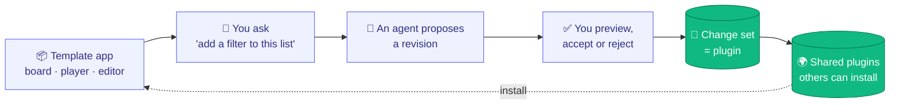
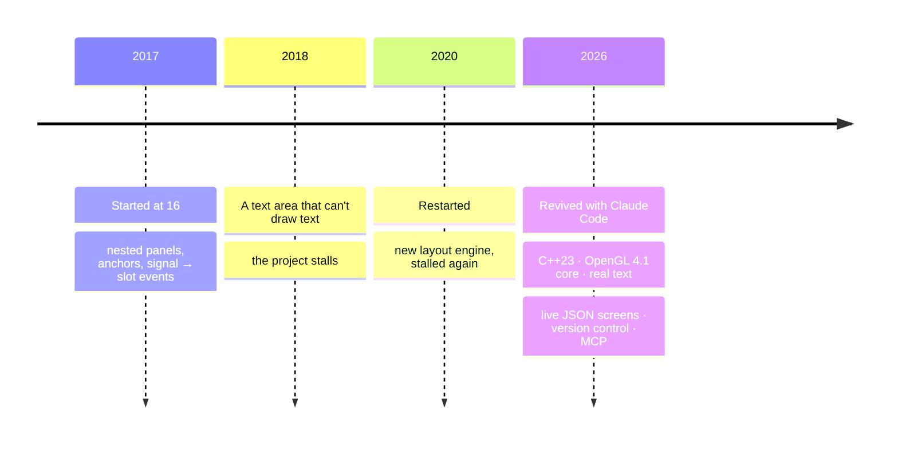

<div align="center">

# AffrescoUI

### Native apps that AI agents can rewrite while they run.<br/>Never without your permission.

[](#use-it-in-your-app)
[](#architecture)
[](mcp/README.md)
[](#native-performance)
[](LICENSE)

**[Architecture](#architecture)** · **[Quick start](#quick-start)** · **[Templates](#templates)** ·
**[How it works](#how-it-works)** ·
**[Screen format](SCREEN_FORMAT.md)** · **[Version control](VERSION_CONTROL.md)** · **[MCP server](mcp/README.md)**

<br/>


<sub>A native C++ / OpenGL Kanban board. Claude Code proposed a new <b>Blocked</b> column over the agent socket: new
data and a five-column layout in one revision. It was reviewed and accepted while the app kept running, and it can
be undone.</sub>

</div>

---

Today, when an AI changes an app, it edits source code, then someone rebuilds and redeploys it. **AffrescoUI works
differently.** The whole UI (layout, state and behaviour) is a **live JSON document** that a native engine renders and
keeps running. People, scripts and AI agents send it **revisions**. The engine checks each one against the screen's
permissions, can show you a **live preview**, and applies it **in place in milliseconds**, while the app keeps
running. Your typing, focus and drags survive.

<table>
<tr>
<td width="50%" align="center"><br/><sub><b>Revision 0</b>: the template as shipped</sub></td>
<td width="50%" align="center"><br/><sub><b>Revision 1</b>: <code>agent/claude-code</code> added a Blocked column</sub></td>
</tr>
</table>

## A new kind of application

Apps have always been frozen at build time: their features are whatever the developers shipped, and changing them
means another release. AffrescoUI apps are **agentic applications**: their behaviour and features stay **malleable
while they run**. An app starts from a template with a set of features, and from there it is directed, not rebuilt.

- **For end users.** You don't need to be a programmer or a product engineer to change how your app works. Ask for
  it (*"create the dark theme of this app"*, *"add a Blocked column"*, *"dim the lights at sunset"*, *"warn me when a
  habit streak breaks"*), and an agent
  turns the request into a revision. You see it live, accept or undo it, and nothing changes without your approval.
- **For developers.** Build a proof of concept agentically and iteratively: describe a screen, let the agent write and
  refine it, and watch every change land in the running app **without ever closing it**. No rebuild, no restart, and
  your state, focus and typing survive. When the PoC is right, it's already a native app: embed the same document
  in C++ with a few lines.

Behaviour that would usually need code (wiring a button to a list, validating a form, filtering on a search,
drag and drop, timers, shortcuts, navigation) is part of the document, so an agent can change it as safely as a colour.

## Architecture

A stack of layers, each with one job, each handing its result to the one below. The four C++ layers are separate
libraries; the MCP server on top is a small Python program.


The layers talk to each other only through small interfaces in `modules/core`, so any of them can be swapped (another
transport, another version-control backend, another document format). `affresco::Screen` (`modules/screen`) plugs
them together. No public header exposes OpenGL or GLFW, and each layer can be linked on its own
(`affrescoui::render`, `affrescoui::vcs`, ...) or all together through `affrescoui::affrescoui`.

```
modules/render/    the renderer: panels, layout, text, input, batched OpenGL (all GL code in src/gl)
modules/format/    the JSON screen format: validation and permission rules, {{expressions}}, Runtime
modules/vcs/       version control: Repository
modules/channel/   transports and the live protocol Session
modules/core/      the interfaces between layers: Executor, Channel, VersionControl, DocumentRules
modules/screen/    affresco::Screen, the composition root, and the umbrella header affresco/affresco.hpp
mcp/               the Python MCP server
schema/            JSON Schema of the screen format
examples/          affrescoui_host, affrescoui_studio, five templates, fonts
external/          vendored glad (OpenGL loader) and stb_truetype
```

## Why it's different

<table>
<tr>
<td width="33%" valign="top">

### 🎨 Truly native
A from-scratch **C++23 / OpenGL** engine. No browser, no web view, a **~1 MB** app binary. A whole frame is
**one draw call** per font, and an idle app uses **0% CPU**.

</td>
<td width="33%" valign="top">

### 📄 Live documents
A whole app in readable JSON: layout, components, state, JS-style `{{expressions}}`, events, timers, screens.
Changes are **compact edits** by node id, atomic, and reconciled **in place**.

</td>
<td width="33%" valign="top">

### 🛡️ Version control built in
**Git's model with Claude Code's approvals:** content-addressed commits, proposals as branches with **live
preview**, merge, revert and diff; `allow` / `ask` / `deny` rules, modes and *"don't ask again"*.
An AI can change your app but **can never approve its own changes**.

</td>
</tr>
<tr>
<td valign="top">

### 🤖 Agent-ready
A **two-way MCP server**: requests from your client reach the agent, and the agent's revisions and replies come back.
Works with Claude Code out of the box.

</td>
<td valign="top">

### 🔌 Any number of peers
Clients, agents and scripts connect over local sockets. The engine doesn't care what they are, only **who they
are**, and a peer's identity is set by the socket it connects to.

</td>
<td valign="top">

### 🧩 Changes become plugins
Export any run of revisions as a **change set**: a small, portable file that anyone with the same template
can review and install.

</td>
</tr>
</table>

## How it works


1. **Anyone can propose a change.** The app (`affrescoui_host`) only renders a screen, here the *Flow* Kanban board, and
   listens for peers on local sockets. You use the **AffrescoUI Studio**. An AI agent connects through the MCP server,
   which works both ways: your requests are pushed into its session, and its replies come back to the Studio. Any
   script can connect too. Every change is a **revision**: compact edits like `{"set": {"#title/text": "Q4"}}`, stored
   as JSON Patch.
2. **The permission rules decide**, written like Claude Code's: `deny` refuses, `ask` sends the change to you, `allow`
   applies it. Rules judge what a change *does*, not how its patch is written. The templates let the Studio change
   anything, always ask before the agent changes behaviour, and protect the status bar.
3. **You review proposals.** A proposal is a branch, like a pull request: the agent can keep refining it while you
   preview it live in the app. Then **Accept**, **Always allow** (don't ask again for that part of the screen) or
   **Reject** with a reason. Switch the mode to *accept edits* or *plan* at any time.
4. **Accepted changes become commits on `main`**, with SHA-256 ids and both the author and the approver recorded. The
   runtime updates the running app in place: no restart, and focus and typing are kept. Any commit can be reverted
   or restored. See [VERSION_CONTROL.md](VERSION_CONTROL.md).

<p align="center">
<br/>
<sub>The <b>AffrescoUI Studio</b>, a client that is itself an AffrescoUI screen (layout, behaviour and its connection, no C++): ask the AI, edit directly, review each change line by line, always allow, revert, restore.</sub>
</p>

## Quick start

```sh
cmake -S . -B build && cmake --build build

./build/affrescoui_host                  # the Kanban board template, listening in /tmp/affrescoui-<uid>
./build/affrescoui_studio                # the client: apply patches, review, ask the AI
```

Then connect an AI agent through MCP ([mcp/README.md](mcp/README.md)):

```sh
claude mcp add affrescoui -- python3 /path/to/AffrescoUI/mcp/affrescoui_mcp.py
claude --dangerously-load-development-channels server:affrescoui   # requests are pushed into the session
```

Type *"add a Blocked column between In progress and Review"* in the Studio. The request reaches Claude, Claude
changes the running board, and the change shows up in the Studio for review. Click **Accept** and the app updates
in place, or **Always allow** to stop being asked about that part of the screen. Switch to **Accept edits** to let
changes apply as they arrive.

```sh
./build/affrescoui_host --mode acceptEdits                              # agent changes apply unless a rule asks
./build/affrescoui_host examples/assets/screens/smart-home.screen.json   # any template or screen file, no C++
./build/affrescoui_host --plugin my-changes.json                         # start with a change set applied
```

Requires CMake ≥ 3.25 and a C++23 compiler. GLFW and nlohmann/json are downloaded automatically. Developed and tested
on macOS. Linux should work but is untested; Windows is not supported yet (the socket and process channels are POSIX).

`python3 tests/render/check.py` (or `ctest --test-dir build`) plays scripted clicks, typing, drags and revisions on
every template and compares each frame with a golden image, pixel for pixel
([tests/render/README.md](tests/render/README.md)).

## Templates

Five starting points, each a single `.screen.json` file with its layout, state and behaviour, and each ready to be
reshaped live by an agent. Open any of them with `./build/affrescoui_host examples/assets/screens/<name>.screen.json`.

<table>
<tr>
<td width="50%" valign="top"><br/><b>Flow</b> · <code>kanban</code><br/><sub>Columns, cards, label filters, drag and drop, a members popover, quick add.</sub></td>
<td width="50%" valign="top"><br/><b>Haven</b> · <code>smart-home</code><br/><sub>Rooms, switches and dimmers, thermostat, blinds, animated scenes, light and dark themes.</sub></td>
</tr>
<tr>
<td valign="top"><br/><b>Tempo</b> · <code>music-player</code><br/><sub>Playlists, a playback timer, seeking, volume, keyboard controls.</sub></td>
<td valign="top"><br/><b>Forge</b> · <code>code-editor</code><br/><sub>A real code editor (selection, undo, Cmd+/, unsaved dots, Cmd+S), explorer, tabs, a terminal that answers, a Cmd+P palette.</sub></td>
</tr>
<tr>
<td valign="top"><br/><b>Streak</b> · <code>habit-tracker</code><br/><sub>Daily habits, streaks, a clickable 20-week grid, kept on disk between runs.</sub></td>
<td valign="top"><br/><sub>Ideas for an agent to try: <i>"add a Blocked column"</i>, <i>"a Movie night scene that dims every light"</i>,
<i>"show the album name under the track title"</i>, <i>"a dark theme for the habit tracker"</i>.</sub></td>
</tr>
</table>

## Native performance

Measured on an Apple M4 Pro (release build) with an earlier chat template: a screen with thousands of wrapped text
items.

| Items on screen | Full frame (draw + GPU) | Keystroke → UI updated | Revision applied |
|---|---|---|---|
| 200 | **0.47 ms** | 1.1 ms | 1.4 ms |
| 1,000 | **0.45 ms** | 4.3 ms | 4.5 ms |
| 3,000 | **0.47 ms** | 12.3 ms | 12.4 ms |

- **Updates scale linearly:** a state change re-evaluates and updates the Kanban template (140 panels) in under 2 ms,
  and a 400-card board (2,662 panels) in 35 ms, about 13 µs per panel.
- **One draw call** per frame per font: rectangles and text share a shader and a texture.
- **No work when idle:** frames are drawn only when something changed, and the app uses 0% CPU while it waits for input.
- **16-byte vertices**, a grow-only index buffer, buffer orphaning, and glyph atlases uploaded once.
- **Small:** an example app is a ~1 MB binary. No browser engine, no web view.

## Use it in your app

```cpp
#include <affresco/affresco.hpp>

int main() {
	affresco::Application app;
	affresco::Screen screen = affresco::Screen::fromFile("app.screen.json");
	screen.createWindow(app);

	screen.onAction("save", [&](affresco::Panel&) { /* native code, if needed */ });
	screen.listen(app, "/tmp/my-app/agent.sock", "agent"); // optional: let other programs change it live
	return app.run();
}
```

```cmake
add_subdirectory(AffrescoUI)   # or FetchContent
target_link_libraries(my_app PRIVATE affrescoui::affrescoui)
```

<details>
<summary><b>Everything the engine does</b></summary>

- **Screen format:** layout (anchors, edges of other nodes, rows, columns, grids, grow, scrolling, overlays), styles,
  components with parameters, themes, fonts, screens and navigation, state, `computed` values, `watch`, JS-style
  `{{expressions}}` (with `filter`, `map`, `sum`, `sort`, ...), `repeat` (keyed) / `when` / `let` / `check`, two-way
  `bind`, value controls (toggle, checkbox, slider), events with bubbling and shortcuts, drag and drop, timers,
  animations and transitions, channels to other programs, state kept on disk, includes, custom native types and
  functions, a catalog for agents.
  Spec: [SCREEN_FORMAT.md](SCREEN_FORMAT.md), with a [JSON Schema](schema/affrescoui-screen.schema.json) for editor
  autocompletion.
- **Live documents:** in-place reconciliation, revisions (compact edits or JSON Patch, atomic, `#id` paths), any number of peers
  over local sockets (or any channel), broadcasts of commits and proposals, request/reply relaying between peers.
- **Version control:** Git's model (SHA-256 commits, an append-only `main`, proposals as branches merged with a merge
  commit, log, diff, revert, restore, `HEAD~1` names) with Claude Code's approvals (`allow` / `ask` / `deny` rules
  judged by effect, modes `default` / `acceptEdits` / `plan`, "don't ask again" grants), reviewers, protected
  controls, approvals pinned to the version reviewed, change sets (plugins).
- **Agents:** a two-way Python MCP server (requests pushed into the agent as channel events, or pulled; changes and
  replies sent back). Reads are minified, and after the first one only the changes come back; an outline and
  single-node reads keep context small. Authors are assigned by the socket a peer uses, never self-declared.
- **UI engine:** nested panels in pixels or percentages, anchors, clipping, rows, columns and grids, scrolling,
  overlays, tooltips, timers, typed input events, mouse capture, hover, cursors, TrueType text with wrap and
  fit-to-text, a text input with caret and paste, a multi-line text editor (selection, undo, clipboard), switches and
  sliders, HiDPI.
- **Examples:** `affrescoui_host` (any screen, the Kanban template by default), five templates and a sign-in screen,
  `affrescoui_studio` (a client that is itself an AffrescoUI screen, connection included), and the MCP server.

</details>

## The vision

The engine is the foundation for a bigger idea at the **application layer**: start from a rich template app, then
**customise it by talking to it**. *"Add a filter to this list"*, *"make the sidebar collapsible"*, *"show the total
in red when it's negative"*. Each request becomes a reviewed revision of the screen. The result is stored as a
**change set**, a small, portable file that works like a **plugin**: others with the same template can share,
review and install it.



This repository is the **engine** that makes that possible: rendering, the live document, version control (permissions, review, history),
change sets and the agent interfaces, plus a template and a client to show them off. The application layer
(template catalogues, a plugin marketplace) builds on top.

## The story


AffrescoUI started in **December 2017** as **sGLGUI**, when I was **16**, as a way to teach myself OpenGL and C++: nested panels,
pixel/percent sizing, anchors and a Qt-style signal/slot system, all from scratch. In 2018 I added a text area. It
collected keystrokes but **could never draw them**, and the project stalled. A restart in 2020 rewrote the layout
engine (the image on the right is that demo), then stalled again.

In **2026** I revived it with **Claude Code**. The first goal was a library you could actually use: we ported it to
OpenGL 4.1 core, rewrote it in C++23 and finally rendered text. Then an idea sparked: what if an AI agent could change
a native app *while it runs*, and you approved every change? That took it far beyond the original plan: UIs described
in JSON, live revisions, version control and a two-way MCP bridge for AI agents.

**How it was built.** To be clear about it: all of the 2026 code was written by Claude Code, through agent-driven
development. What I brought is the direction and the architecture. I shaped it over many iterations, trying an idea,
looking at what it did and changing course, until it worked the way I wanted. The git history shows every step.



## License

**Apache License 2.0**: free to use, modify and distribute, commercially or not. Anyone who distributes it must pass
on the [NOTICE](NOTICE) file, which credits the author. See [LICENSE](LICENSE) and
[THIRD_PARTY_NOTICES.md](THIRD_PARTY_NOTICES.md).

<div align="center">
<br/>

**Created by [Riccardo Sottini](https://github.com/RiccardoSottini)** · 2017–2026

<sub>If AffrescoUI made you think "wait, an AI can change a native app *while it runs*?", leave a ⭐.</sub>

</div>
