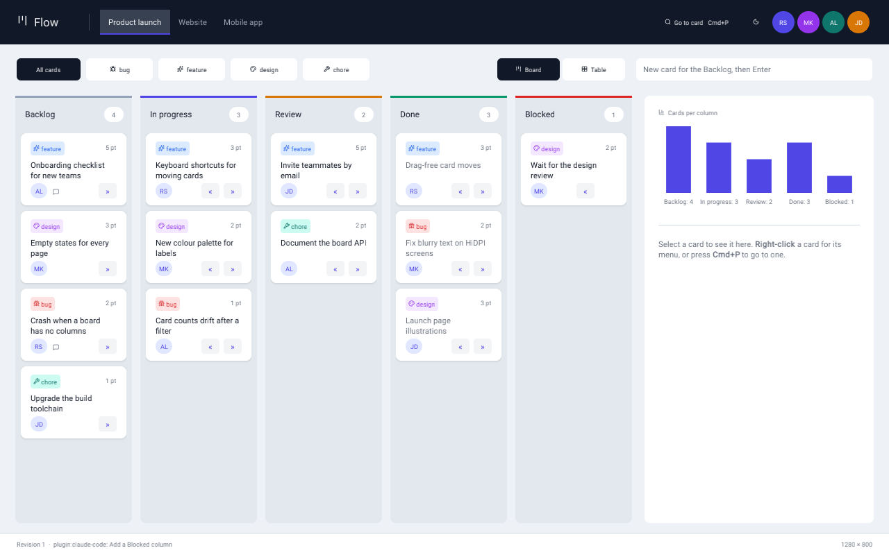
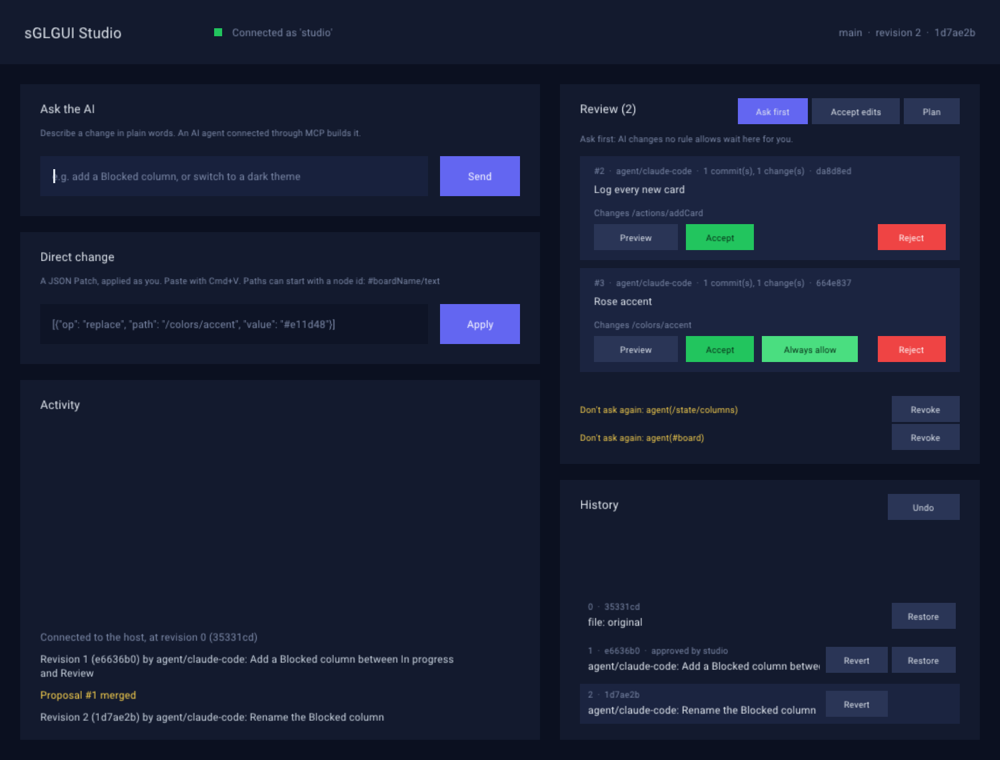
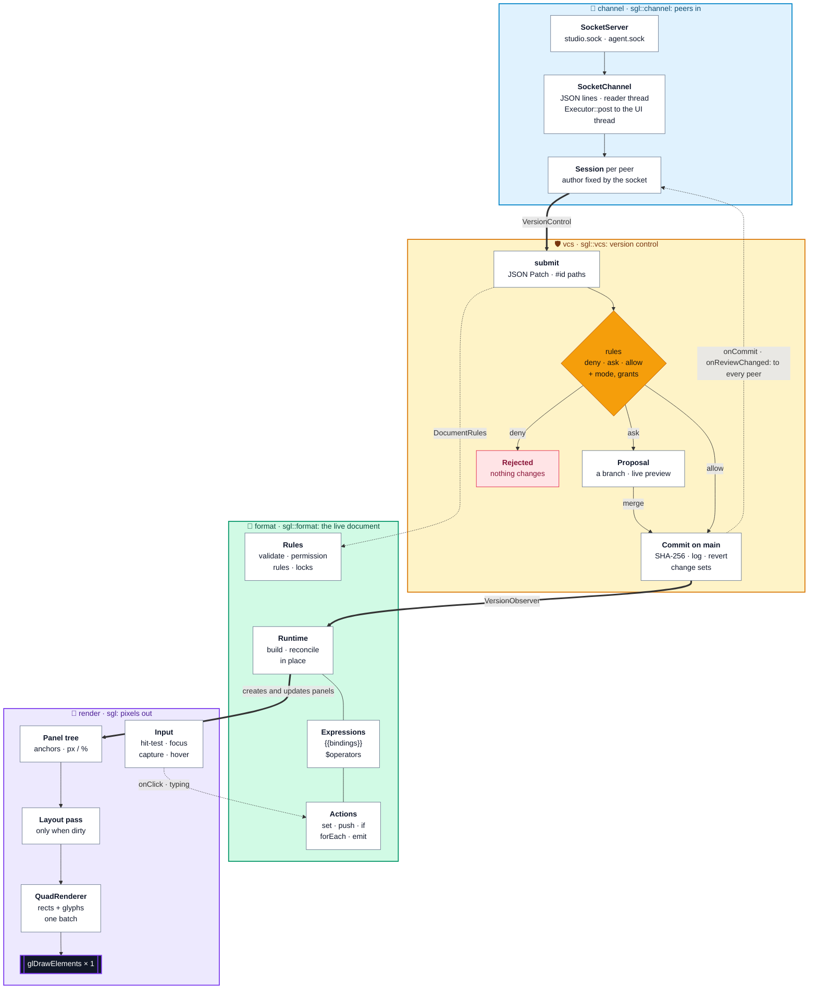
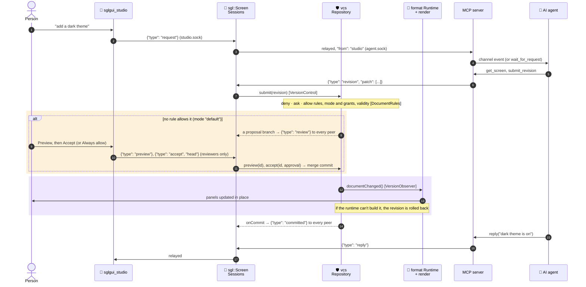
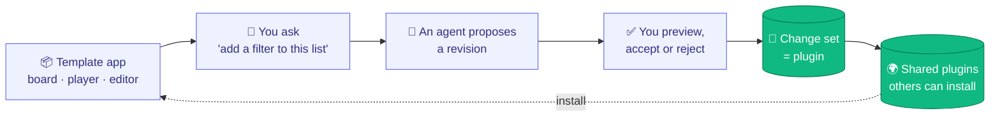
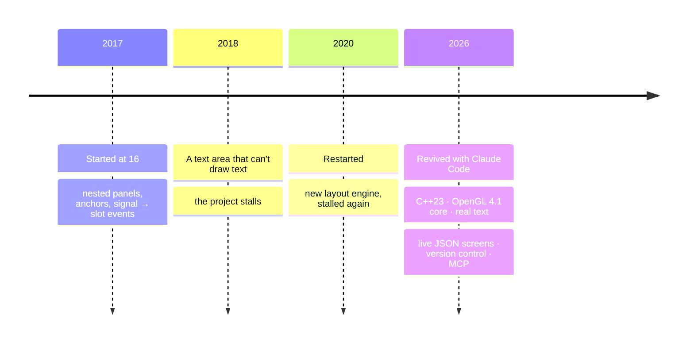

<div align="center">

# sGLGUI

### Native apps that AI agents can rewrite while they run.<br/>Never without your permission.

[](#use-it-in-your-app)
[](#under-the-hood)
[](mcp/README.md)
[](#native-performance)
[](#quick-start)
[](LICENSE)

**[Quick start](#quick-start)** · **[Templates](#templates)** · **[How it works](#how-it-works)** ·
**[Under the hood](#under-the-hood)** ·
**[Screen format](SCREEN_FORMAT.md)** · **[Version control](VERSION_CONTROL.md)** · **[MCP server](mcp/README.md)**

<br/>



<sub>A native C++ / OpenGL Kanban board. Claude Code proposed a new <b>Blocked</b> column over the agent socket: new
data and a five-column layout in one revision. It was reviewed and accepted while the app kept running, and it can
be undone.</sub>

</div>

---

Today, when an AI changes an app, it edits source code, then someone rebuilds and redeploys it. **sGLGUI works
differently.** The whole UI (layout, state and behaviour) is a **live JSON document** that a native engine renders and
keeps running. People, scripts and AI agents send it **revisions**. The engine checks each one against the screen's
permissions, can show you a **live preview**, and applies it **in place in milliseconds**, while the app keeps
running. Your typing, focus and drags survive.

<table>
<tr>
<td width="50%" align="center"><br/><sub><b>Revision 0</b>: the template as shipped</sub></td>
<td width="50%" align="center"><br/><sub><b>Revision 1</b>: <code>agent/claude-code</code> added a Blocked column</sub></td>
</tr>
</table>

## Why it's different

<table>
<tr>
<td width="33%" valign="top">

### 🎨 Truly native
A from-scratch **C++23 / OpenGL** engine. No browser, no web view, a **~1 MB** app binary. A whole frame is
**one draw call** per font, and an idle app uses **0% CPU**.

</td>
<td width="33%" valign="top">

### 📄 Live documents
Layout, styles, state, `{{bindings}}`, loops and actions, all in JSON. Revisions are standard **JSON Patch**,
atomic, and reconciled **in place**.

</td>
<td width="33%" valign="top">

### 🛡️ Version control built in
**Git's model with Claude Code's approvals:** content-addressed commits, proposals as branches with **live
preview**, merge, revert and diff; `allow` / `ask` / `deny` rules, modes and *"don't ask again"*.
An AI can change your app but **can never approve its own changes**.

</td>
</tr>
<tr>
<td valign="top">

### 🤖 Agent-ready
A **two-way MCP server**: requests from your client reach the agent, and the agent's revisions and replies come back.
Works with Claude Code out of the box.

</td>
<td valign="top">

### 🔌 Any number of peers
Clients, agents and scripts connect over local sockets. The engine doesn't care what they are, only **who they
are**, and a peer's identity is set by the socket it connects to.

</td>
<td valign="top">

### 🧩 Changes become plugins
Export any run of revisions as a **change set**: a small, portable file that anyone with the same template
can review and install.

</td>
</tr>
</table>

## How it works


1. **Anyone can propose a change.** The app (`sglgui_host`) only renders a screen, here the *Flow* Kanban board, and
   listens for peers on local sockets. You use the **sGLGUI Studio**. An AI agent connects through the MCP server,
   which works both ways: your requests are pushed into its session, and its replies come back to the Studio. Any
   script can connect too. Every change is a **revision**: a JSON Patch.
2. **The permission rules decide**, written like Claude Code's: `deny` refuses, `ask` sends the change to you, `allow`
   applies it. Rules judge what a change *does*, not how its patch is written. The templates let the Studio change
   anything, always ask before the agent changes behaviour, and protect the status bar.
3. **You review proposals.** A proposal is a branch, like a pull request: the agent can keep refining it while you
   preview it live in the app. Then **Accept**, **Always allow** (don't ask again for that part of the screen) or
   **Reject** with a reason. Switch the mode to *accept edits* or *plan* at any time.
4. **Accepted changes become commits on `main`**, with SHA-256 ids and both the author and the approver recorded. The
   runtime updates the running app in place: no restart, and focus and typing are kept. Any commit can be reverted
   or restored. See [VERSION_CONTROL.md](VERSION_CONTROL.md).

<p align="center">
<br/>
<sub>The <b>sGLGUI Studio</b>, a client that is itself an sGLGUI screen: ask the AI, patch directly, review, always allow, revert, restore.</sub>
</p>

## Quick start

```sh
cmake -S . -B build && cmake --build build

./build/sglgui_host                  # the Kanban board template, listening in /tmp/sglgui-<uid>
./build/sglgui_studio                # the client: apply patches, review, ask the AI
```

Then connect an AI agent through MCP ([mcp/README.md](mcp/README.md)):

```sh
claude mcp add sglgui -- python3 /path/to/sGLGUI/mcp/sglgui_mcp.py
claude --dangerously-load-development-channels server:sglgui   # requests are pushed into the session
```

Type *"add a Blocked column between In progress and Review"* in the Studio. The request reaches Claude, Claude
changes the running board, and the change shows up in the Studio for review. Click **Accept** and the app updates
in place, or **Always allow** to stop being asked about that part of the screen. Switch to **Accept edits** to let
changes apply as they arrive.

```sh
./build/sglgui_host --mode acceptEdits                              # agent changes apply unless a rule asks
./build/sglgui_host examples/assets/screens/smart-home.screen.json   # any template or screen file, no C++
./build/sglgui_host --plugin my-changes.json                         # start with a change set applied
```

Requires CMake ≥ 3.25 and a C++23 compiler. GLFW and nlohmann/json are downloaded automatically. Tested on macOS; the
socket and process channels are POSIX.

## Templates

Five starting points, each a single `.screen.json` file with its layout, state and behaviour, and each ready to be
reshaped live by an agent. Open any of them with `./build/sglgui_host examples/assets/screens/<name>.screen.json`.

<table>
<tr>
<td width="50%" valign="top"><br/><b>Flow</b> · <code>kanban</code><br/><sub>Columns, cards, label filters, moving cards, quick add.</sub></td>
<td width="50%" valign="top"><br/><b>Haven</b> · <code>smart-home</code><br/><sub>Rooms, light switches and dimming, thermostat, blinds, scenes.</sub></td>
</tr>
<tr>
<td valign="top"><br/><b>Tempo</b> · <code>music-player</code><br/><sub>Playlists, track list, now playing, play/pause, next, volume.</sub></td>
<td valign="top"><br/><b>Forge</b> · <code>code-editor</code><br/><sub>Explorer, tabs, highlighted code, a terminal that answers.</sub></td>
</tr>
<tr>
<td valign="top"><br/><b>Streak</b> · <code>habit-tracker</code><br/><sub>Daily habits, streaks, a clickable 20-week grid, weekly progress.</sub></td>
<td valign="top"><br/><sub>Ideas for an agent to try: <i>"add a Blocked column"</i>, <i>"a Movie night scene that dims every light"</i>,
<i>"show the album name under the track title"</i>, <i>"a dark theme for the habit tracker"</i>.</sub></td>
</tr>
</table>

## Under the hood

The engine is **five independent modules**. Each one is its own library target and talks to the others **only through
interfaces** in `core`: no module includes or links another module's implementation. `sgl::Screen` plugs them
together, and any of them can be swapped for another implementation of the same interface (another transport,
another version-control backend, another document format).



| Module | Namespace | Responsibility | Depends on |
|---|---|---|---|
| `core` | `sgl` | The contracts: `Executor`, `Channel`, `VersionControl`, `VersionObserver`, `DocumentRules`; `Signal`, JSON types | nlohmann/json (only for the document interfaces) |
| `render` | `sgl` | Rendering engine: windows, panel tree, layout, input, text, clipboard, batched OpenGL renderer. No JSON. | `core` |
| `format` | `sgl::format` | The JSON screen format: validation and permission rules (`Rules`), `{{expressions}}`, and `Runtime`, which builds a document into panels, reconciles on change and runs actions | `core`, `render` |
| `vcs` | `sgl::vcs` | Git-like version control for any JSON document: content-addressed commits, `main`, proposals as branches, merge, preview, log, diff, revert, restore, change sets; allow / ask / deny rules judged by effect, modes, grants | `core` |
| `channel` | `sgl::channel` | Communication: local-socket server and client, child-process and stdio transports, and `Session`, the live JSON-lines protocol | `core` |
| `sglgui` | `sgl` | `sgl::Screen`: wires `Rules` → `Repository` → `Runtime`, plus one `Session` per peer, relaying requests between peers | all of the above |

### The life of a revision



The app's own interactions (clicks, typing, actions in the screen file) change its state locally. `emit` steps send
events to every peer.

## Native performance

Measured on an Apple M4 Pro (release build) with an earlier chat template: a screen with thousands of wrapped text
items.

| Items on screen | Full frame (draw + GPU) | Keystroke → UI updated | Revision applied |
|---|---|---|---|
| 200 | **0.47 ms** | 1.1 ms | 1.4 ms |
| 1,000 | **0.45 ms** | 4.3 ms | 4.5 ms |
| 3,000 | **0.47 ms** | 12.3 ms | 12.4 ms |

- **One draw call** per frame per font: rectangles and text share a shader and a texture.
- **No work when idle:** frames are drawn only when something changed, and the app uses 0% CPU while it waits for input.
- **16-byte vertices**, a grow-only index buffer, buffer orphaning, and glyph atlases uploaded once.
- **Small:** an example app is a ~1 MB binary. No browser engine, no web view.

## Use it in your app

```cpp
#include <sgl/sgl.hpp>

int main() {
	sgl::Application app;
	sgl::Screen screen = sgl::Screen::fromFile("app.screen.json");
	screen.createWindow(app);

	screen.onAction("save", [&](sgl::Panel&) { /* native code, if needed */ });
	screen.listen(app, "/tmp/my-app/agent.sock", "agent"); // optional: let other programs change it live
	return app.run();
}
```

```cmake
add_subdirectory(sGLGUI)   # or FetchContent
target_link_libraries(my_app PRIVATE sglgui::sglgui)
```

<details>
<summary><b>Everything the engine does</b></summary>

- **Screen format:** layout, styles, named colors, fonts, templates, state, `{{bindings}}`, `$` operators,
  `repeat` / `when`, two-way `bind`, actions with conditions and loops, custom native types.
  Spec: [SCREEN_FORMAT.md](SCREEN_FORMAT.md), with a [JSON Schema](schema/sglgui-screen.schema.json) for editor
  autocompletion.
- **Live documents:** in-place reconciliation, revisions (JSON Patch, atomic, `#id` paths), any number of peers
  over local sockets (or any channel), broadcasts of commits and proposals, request/reply relaying between peers.
- **Version control:** Git's model (SHA-256 commits, an append-only `main`, proposals as branches merged with a merge
  commit, log, diff, revert, restore, `HEAD~1` names) with Claude Code's approvals (`allow` / `ask` / `deny` rules
  judged by effect, modes `default` / `acceptEdits` / `plan`, "don't ask again" grants), reviewers, protected
  controls, approvals pinned to the version reviewed, change sets (plugins).
- **Agents:** a two-way Python MCP server (requests pushed into the agent as channel events, or pulled; changes and
  replies sent back). Authors are assigned by the socket a peer uses, never self-declared.
- **UI engine:** nested panels in pixels or percentages, anchors, clipping, stacks, typed input events, mouse
  capture, hover, cursors, TrueType text with wrap and fit-to-text, a text input with caret and paste, HiDPI.
- **Examples:** `sglgui_host` (any screen, the Kanban template by default), five templates, `sglgui_studio` (a client that is
  itself an sGLGUI screen), and the MCP server.

</details>

## The vision

The engine is the foundation for a bigger idea at the **application layer**: start from a rich template app, then
**customise it by talking to it**. *"Add a filter to this list"*, *"make the sidebar collapsible"*, *"show the total
in red when it's negative"*. Each request becomes a reviewed revision of the screen. The result is stored as a
**change set**, a small, portable file that works like a **plugin**: others with the same template can share,
review and install it.



This repository is the **engine** that makes that possible: rendering, the live document, version control (permissions, review, history),
change sets and the agent interfaces, plus a template and a client to show them off. The application layer
(template catalogues, a plugin marketplace) builds on top.

## The story


sGLGUI started in **December 2017**, when I was **16**, as a way to teach myself OpenGL and C++: nested panels,
pixel/percent sizing, anchors and a Qt-style signal/slot system, all from scratch. In 2018 I added a text area. It
collected keystrokes but **could never draw them**, and the project stalled. A restart in 2020 rewrote the layout
engine (the image on the right is that demo), then stalled again.

In **2026** I revived it with **Claude Code**. We ported it to OpenGL 4.1 core, rewrote it in C++23, finally rendered
text, and then took it further than the original plan: UIs described in JSON, live revisions, version control and a
two-way MCP bridge for AI agents. The layout ideas from 2017 still drive every frame.



## Project layout

```
modules/core/      interfaces between modules (include/sgl/core): Executor, Channel, VersionControl, DocumentRules
modules/render/    rendering engine (include/sgl/render; src/gl: all OpenGL code, src/detail: UTF-8, PPM)
modules/format/    JSON screen format: Rules, expressions, Runtime (include/sgl/format)
modules/vcs/       version control: Repository (include/sgl/vcs)
modules/channel/   transports and the live protocol Session (include/sgl/channel)
modules/screen/    sgl::Screen, the composition root, and the umbrella header sgl/sgl.hpp
mcp/               the Python MCP server
schema/            JSON Schema of the screen format
examples/          sglgui_host, sglgui_studio, templates (kanban, smart-home, music-player, code-editor,
                   habit-tracker), studio and sign-in screens, fonts
external/          vendored glad (OpenGL loader) and stb_truetype
```

No public header exposes OpenGL or GLFW. Each module can be linked on its own (`sglgui::render`, `sglgui::vcs`, ...)
or all together through `sglgui::sglgui`.

## License

**Apache License 2.0**: free to use, modify and distribute, commercially or not. Anyone who distributes it must pass
on the [NOTICE](NOTICE) file, which credits the author. See [LICENSE](LICENSE) and
[THIRD_PARTY_NOTICES.md](THIRD_PARTY_NOTICES.md).

<div align="center">
<br/>

**Created by [Riccardo Sottini](https://github.com/RiccardoSottini)** · 2017–2026

<sub>If sGLGUI made you think "wait, an AI can change a native app *while it runs*?", leave a ⭐.</sub>

</div>
