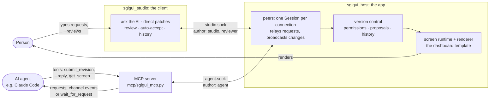
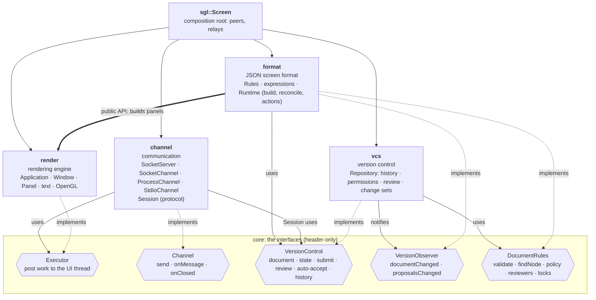
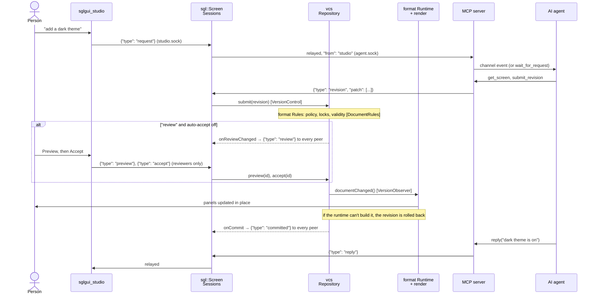
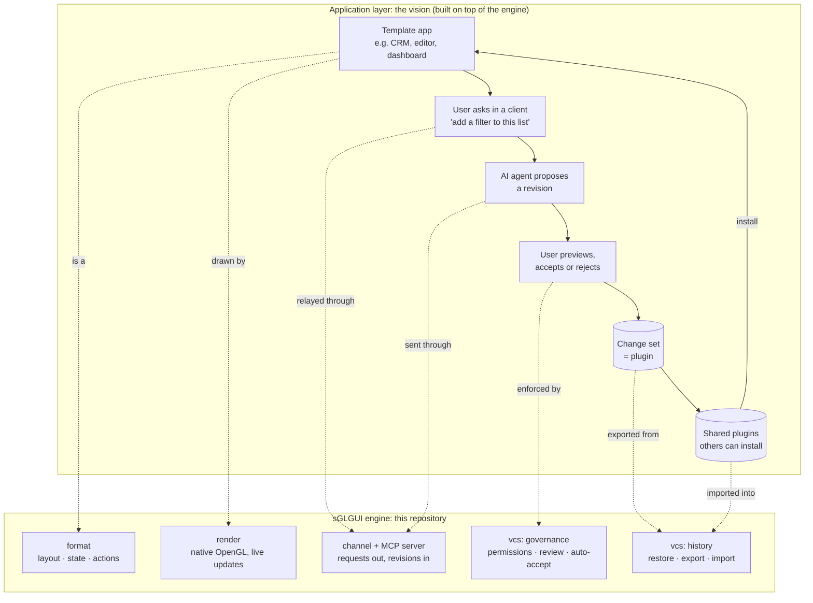

# sGLGUI

A native **rendering engine for AI-driven interfaces**, written from scratch in **C++23** and **OpenGL 4.1 core**.

An application's whole UI, its layout, state and behaviour, is a JSON document that the engine renders natively and
keeps **live**. While it runs, any number of programs can change it through **revisions**: the person's own client, an
AI agent through MCP, a script. The engine doesn't care where a change comes from. It cares who sent it: permissions
decide who may change what, reviewers approve proposals (or switch on auto-accept), and the full history can be
restored, exported and shared.

Created by Riccardo Sottini. Started in 2017 as a way to learn OpenGL and C++, revived in 2026.

## How it works



1. **The app** (`sglgui_host`) renders a screen, here a dashboard template, and nothing else. It has no chat box or
   command line: it listens for **peers** on local sockets and treats them all the same way.
2. **The person** uses a separate client, the **sGLGUI Studio**: ask the AI for a change in plain words, apply a JSON
   Patch directly, review the agent's proposals (preview them live in the app), switch auto-accept, browse and restore
   the history.
3. **The MCP server** works in both directions. Requests from the Studio are pushed into the agent's session (Claude
   Code channel events), or picked up with `wait_for_request`. The agent's tool calls become revisions on the app,
   and its `reply` goes back to the Studio.
4. **Every change is governed** by the screen's permissions: the template lets the Studio change anything and review,
   while the agent's changes wait for review unless auto-accept is on. See [GOVERNANCE.md](GOVERNANCE.md).

## Try it

```sh
cmake -S . -B build && cmake --build build

./build/sglgui_host                  # the dashboard template, listening in /tmp/sglgui-<uid>
./build/sglgui_studio                # the client: apply patches, review, ask the AI
```

Then connect an AI agent through MCP ([mcp/README.md](mcp/README.md)):

```sh
claude mcp add sglgui -- python3 /path/to/sGLGUI/mcp/sglgui_mcp.py
claude --dangerously-load-development-channels server:sglgui   # requests are pushed into the session
```

Type "build the Customers page with a table of five customers" in the Studio: the request reaches Claude, Claude
changes the running dashboard, the change shows up in the Studio for review, and after Accept the app updates in
place. Switch on **Auto-accept** to let changes apply as they come.

More:
```sh
./build/sglgui_host --auto-accept                                    # agent changes apply without review
./build/sglgui_host examples/assets/screens/sign-in.screen.json      # any screen file, no C++
./build/sglgui_host --plugin my-changes.json                         # start with a change set applied
```

## Architecture
The engine is five independent modules. Each one is its own library target and talks to the others **only through
interfaces** in `core`: no module includes or links against another module's implementation. `sgl::Screen` is the
composition root that plugs them together, and any of them can be swapped for another implementation of the same
interface (another transport, another version-control backend, another document format).



| Module | Namespace | Responsibility | Depends on |
|---|---|---|---|
| `core` | `sgl` | The contracts: `Executor`, `Channel`, `VersionControl`, `VersionObserver`, `DocumentRules`; `Signal`, JSON types | nlohmann/json (only for the document interfaces) |
| `render` | `sgl` | Rendering engine: windows, panel tree, layout, input, text, clipboard, batched OpenGL renderer. No JSON. | `core` |
| `format` | `sgl::format` | The JSON screen format: validation and permission rules (`Rules`), `{{expressions}}`, and `Runtime`, which builds a document into panels, reconciles on change and runs actions | `core`, `render` |
| `vcs` | `sgl::vcs` | Version control for any JSON document: revisions (JSON Patch, `#id` paths), per-author policies, reviewers, auto-accept, locks, proposals, preview, history, restore, change sets | `core` |
| `channel` | `sgl::channel` | Communication: local-socket server and client, child-process and stdio transports, and `Session`, the live JSON-lines protocol | `core` |
| `sglgui` | `sgl` | `sgl::Screen`: wires `Rules` → `Repository` → `Runtime`, plus one `Session` per peer, relaying requests between peers | all of the above |

### How a change flows



The app's own interactions (clicks, typing, actions in the screen file) change its state locally; `emit` steps send
events to every peer.

## The vision
The engine is the foundation for a larger idea, at the **application layer**: a user starts from a rich template
application, then **customises it by talking to it**. "Add a filter to this list", "make the sidebar collapsible",
"show the total in red when it's negative". Each request becomes a reviewed revision of the screen. The result is
stored as a **change set**, a small, portable file that works like a **plugin**: it can be shared, reviewed and
installed by others on the same template.



This repository is the **engine** that makes that possible: rendering, the live document, governance, history,
change sets and the agent interfaces, with a template and a client to show them. The application layer (template
catalogues, a plugin marketplace) builds on top.

## Native performance
Measured on an Apple M4 Pro (release build) with the earlier chat template: a screen with thousands of wrapped
text items:

| Items on screen | Full frame (draw + GPU) | Keystroke → UI updated | Revision applied |
|---|---|---|---|
| 200 | 0.47 ms | 1.1 ms | 1.4 ms |
| 1,000 | 0.45 ms | 4.3 ms | 4.5 ms |
| 3,000 | 0.47 ms | 12.3 ms | 12.4 ms |

- **One draw call** per frame per font: rectangles and text share a shader and a texture.
- **No work when idle:** frames are drawn only when something changed; 0% CPU while waiting for input.
- **16-byte vertices**, a grow-only index buffer, buffer orphaning, glyph atlases uploaded once.
- **Small:** an example app is a ~1 MB binary. No browser engine, no web view.

## Features
- **Screen format:** layout, styles, named colors, fonts, templates, state, `{{bindings}}`, `$` operators,
  `repeat` / `when`, two-way `bind`, actions with conditions and loops, custom native types
- **Live documents:** in-place reconciliation, revisions (JSON Patch, atomic, `#id` paths), any number of peers
  over local sockets (or any channel), broadcasts of commits and proposals, request/reply relaying between peers
- **Governance:** per-author policies (allow / review / deny), reviewers, auto-accept, locked parts, protected
  controls, proposals with live preview, accept/reject, an audit history, restore, change sets (plugins)
- **Agents:** a two-way Python MCP server (requests pushed into the agent as channel events, or pulled; changes and
  replies back); authors are assigned by the socket a peer uses, never self-declared
- **UI engine:** nested panels in pixels or percentages, anchors, clipping, stacks, typed input events, mouse
  capture, hover, cursors, TrueType text with wrap and fit-to-text, a text input with caret and paste, HiDPI
- **Examples:** `sglgui_host` (any screen, the dashboard template by default), `sglgui_studio` (a client that is
  itself an sGLGUI screen), the MCP server

## Using the library

```cpp
#include <sgl/sgl.hpp>

int main() {
	sgl::Application app;
	sgl::Screen screen = sgl::Screen::fromFile("app.screen.json");
	screen.createWindow(app);

	screen.onAction("save", [&](sgl::Panel&) { /* native code, if needed */ });
	screen.listen(app, "/tmp/my-app/agent.sock", "agent"); // optional: let other programs change it live
	return app.run();
}
```

```cmake
add_subdirectory(sGLGUI)   # or FetchContent
target_link_libraries(my_app PRIVATE sglgui::sglgui)
```

Requires CMake ≥ 3.25 and a C++23 compiler. GLFW and nlohmann/json are downloaded automatically.

## Project layout
```
modules/core/      interfaces between modules (include/sgl/core): Executor, Channel, VersionControl, DocumentRules
modules/render/    rendering engine (include/sgl/render; src/gl: all OpenGL code, src/detail: UTF-8, PPM)
modules/format/    JSON screen format: Rules, expressions, Runtime (include/sgl/format)
modules/vcs/       version control: Repository (include/sgl/vcs)
modules/channel/   transports and the live protocol Session (include/sgl/channel)
modules/screen/    sgl::Screen, the composition root, and the umbrella header sgl/sgl.hpp
mcp/               the Python MCP server
schema/            JSON Schema of the screen format
examples/          sglgui_host, sglgui_studio, screens (dashboard, studio, sign-in), fonts
external/          vendored glad (OpenGL loader) and stb_truetype
```
No public header exposes OpenGL or GLFW. Each module can be linked on its own (`sglgui::render`, `sglgui::vcs`, ...)
or all together through `sglgui::sglgui`.

## License
**Apache License 2.0**: free to use, modify and distribute, commercially or not. Anyone who distributes it must pass
on the [NOTICE](NOTICE) file, which credits the author. Copyright (c) 2017-2026 Riccardo Sottini. See
[LICENSE](LICENSE) and [THIRD_PARTY_NOTICES.md](THIRD_PARTY_NOTICES.md).
