<div align="center">


# AffrescoUI

### Any application, written in one format and rendered natively.<br/>Its users reshape it live, just by asking an AI.

[](#use-it-in-your-app)
[](#architecture)
[](#quick-start)
[](mcp/README.md)
[](BENCHMARKS.md)
[](LICENSE)

**[Vision](#the-vision)** · **[Applications](#applications)** · **[Architecture](#architecture)** ·
**[How it works](#how-it-works)** · **[Quick start](#quick-start)** · **[Documentation](#documentation)**

<br/>

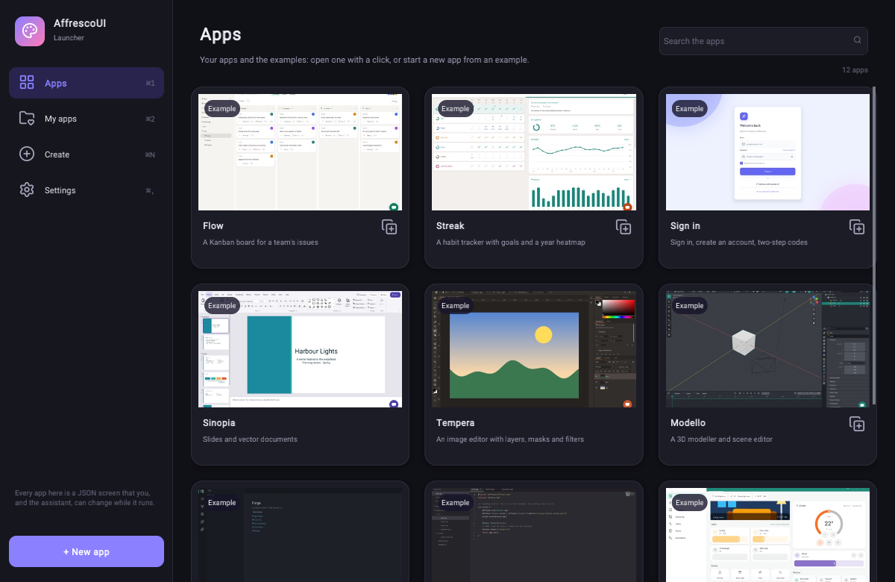

<sub>The AffrescoUI Launcher, itself one live document: every application one click away, your own apps, a new app
made blank, from an example or from a description, and the AI provider every app's assistant uses.</sub>

</div>

---

> [!WARNING]
> **The v1.0.0 downloads are not code-signed yet**, so macOS and Windows warn that they can't verify the developer when you first open them. Signed builds will come in the next releases.
>
> **Best today: build from source.** It's one command, gives an optimised build for your machine, and never shows that warning (you need CMake 3.25+ and a C++23 compiler):
>
> ```sh
> cmake -S . -B build && cmake --build build && ./build/affrescoui_launcher
> ```

AffrescoUI is a native UI engine that renders every application from one document format. An application's layout,
state and behaviour live in a single readable document, which the engine draws in C++ and OpenGL and keeps running.
People and AI agents change that document while the app runs: each change is checked against the app's permissions,
previewed if it needs approval, and applied in place in milliseconds, with no rebuild, no restart and nothing lost.

## The vision

Software is frozen at build time: it does what its makers shipped, and every change waits for the next release.
AffrescoUI applications keep evolving while they are used, shaped by the people who use them.

- **One format for every application.** A to-do list and a professional design tool are written the same way and
  rendered by the same native engine. A feature built for one application can move into another.
- **Complex applications, built by anyone.** No programming needed: describe what you want, and an AI agent builds it
  with you, step by step, from a simple board to a full workbench.
- **The people who use an app can change it.** Ask the app itself, in plain words: *"add a Blocked column"*, *"dim
  the lights at sunset"*, *"warn me when a streak breaks"*. You see the change live, then keep it or undo it. Nothing
  changes without your approval.
- **Prototyping without stopping.** Every idea is tried in the running application: no rebuilding, no restarting, no
  reloading, and your work stays where it was. When the prototype is right, it is already the app.

## How an application grows

An application starts from a document, then **grows by being talked to**: *"add a filter to this list"*, *"make the
sidebar collapsible"*, *"show the total in red when it's negative"*. Each request becomes a reviewed revision. A run
of revisions becomes a **change set**, a portable file that works like a **plugin**, and whole features move between
applications: the planetarium below reuses the presentation editor's slide sorter.

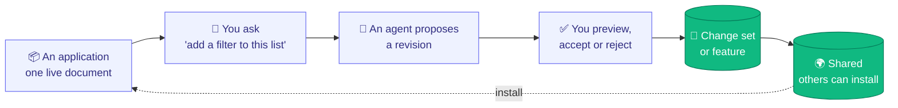

The direction: applications as complex as the professional tools people use every day, in one format, rendered
natively, and shaped by the people who use them while they run.

## Applications

Twelve applications, from everyday apps to professional tools, all in the same format. They are examples
([`examples/`](examples/README.md)), not part of the library, and each carries the AI **assistant** in its bottom right
corner: ask for a change in plain words, then review the proposal it becomes.

### Professional tools

<table>
<tr>
<td width="50%" valign="top">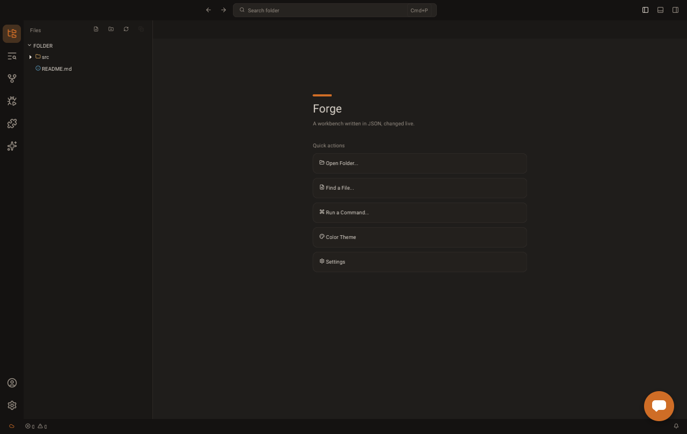<br/><b>Forge</b> · an IDE<br/><sub>Explorer, editor tabs and split editors, find and replace, quick open and a command palette, problems, output and a terminal, source control, a debugger and language servers, in dark, light and high-contrast themes. <code>examples/forge/index.screen.json</code>, with <code>--folder DIR</code> to open a folder</sub></td>
<td width="50%" valign="top">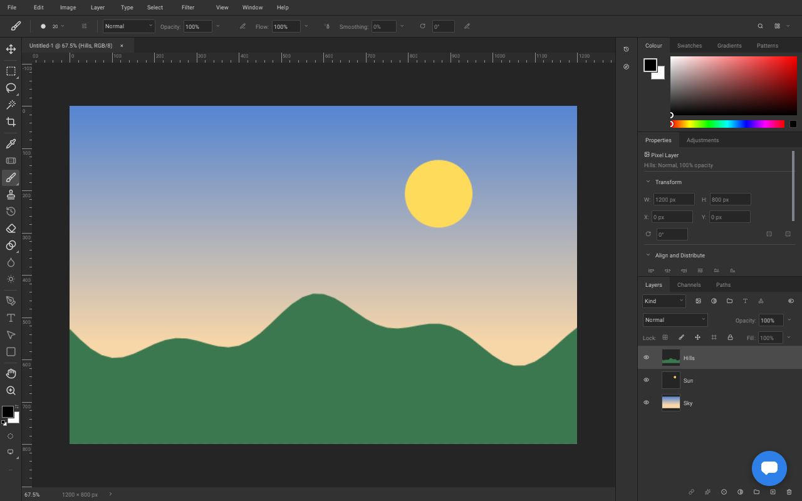<br/><b>Tempera</b> · an image editor<br/><sub>Tools with flyouts and a context options bar, layers with masks, groups and adjustment layers, brushes, selections, history and a navigator, on a tiled image engine. Agents may only propose: every change is reviewed. <code>examples/tempera/index.screen.json</code></sub></td>
</tr>
<tr>
<td valign="top"><br/><b>Sinopia</b> · a presentation editor<br/><sub>A ribbon with tabs and galleries, slide thumbnails in sections, a canvas with shapes, zoom and fit, speaker notes and undo. Its slide sorter is a part that other applications install. <code>examples/sinopia/index.screen.json</code></sub></td>
<td valign="top">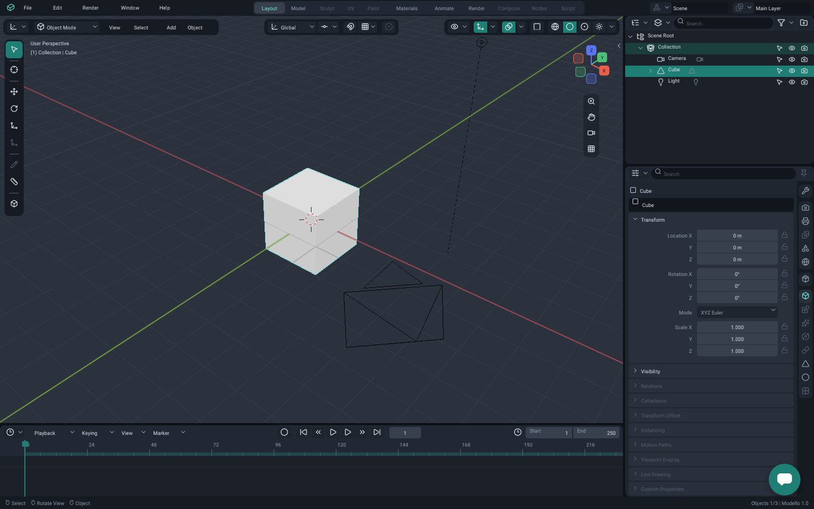<br/><b>Modello</b> · a 3D modeller<br/><sub>A lit 3D viewport with gizmos, an outliner, a properties editor, a timeline, search over every command and glTF import. Every scene edit is a revision, reviewed and undoable. No C++ of its own. <code>examples/modello/index.screen.json</code></sub></td>
</tr>
<tr>
<td valign="top">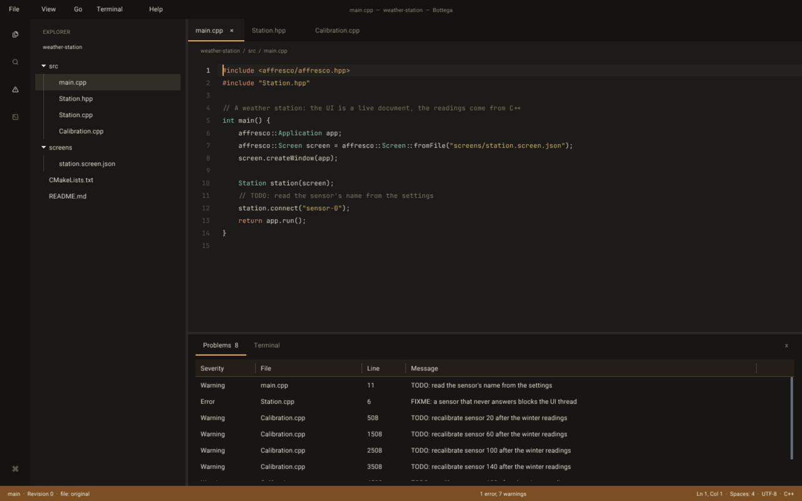<br/><b>Quaderno</b> · a code editor<br/><sub>Open files and folders, tabs, a minimap, a quick switcher over files, symbols and lines, Find in Files, a command palette and a console. <code>examples/code-editor/index.screen.json</code></sub></td>
<td valign="top">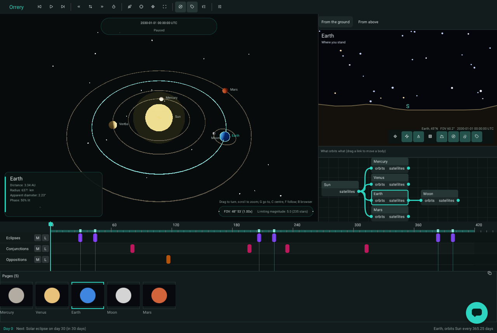<br/><b>Orrery</b> · a planetarium<br/><sub>A 3D solar system, the sky from the ground, an orbit graph and a timeline of eclipses. Its bodies strip is Sinopia's slide sorter, installed from that app. Built by an outsider from the public docs. <code>examples/orrery/index.screen.json</code></sub></td>
</tr>
</table>

### Everyday apps

<table>
<tr>
<td width="50%" valign="top">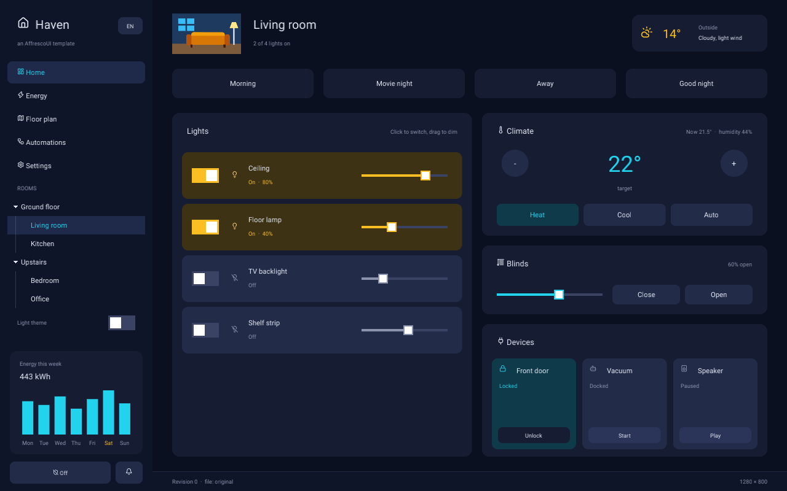<br/><b>Haven</b> · a smart-home dashboard<br/><sub>Rooms by floor, a floor plan, scenes, lights, climate, blinds and media, automations as a node graph with schedules, energy charts, security and notifications, on simulated devices. <code>examples/haven/index.screen.json</code></sub></td>
<td width="50%" valign="top">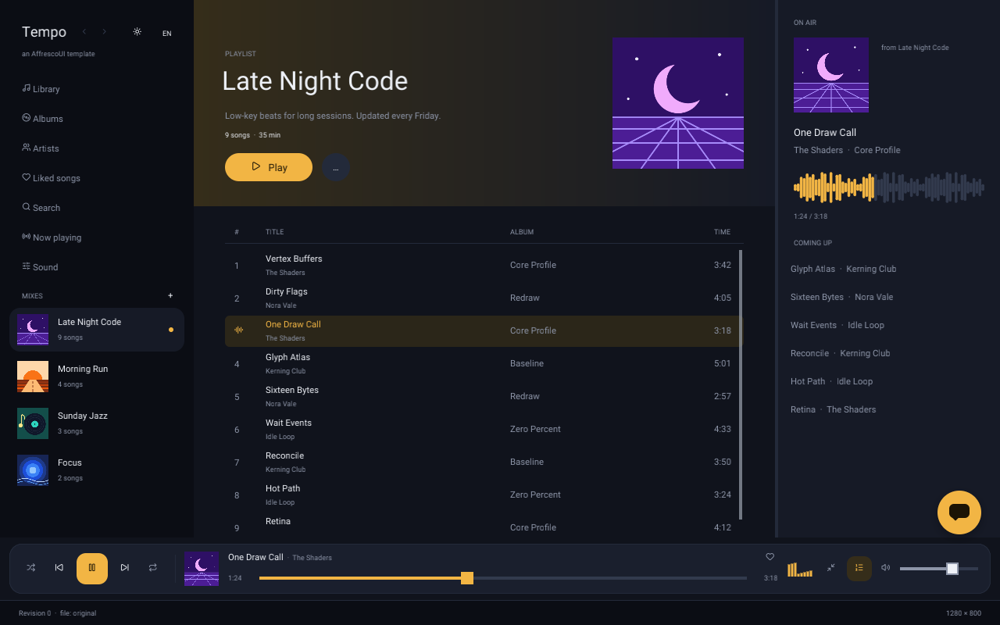<br/><b>Tempo</b> · a music player<br/><sub>Playlists, a 3,000-song library, albums and artists, a queue to reorder, now playing with a visualiser and lyrics, an equaliser and a mini player. Playback is simulated. <code>examples/tempo/index.screen.json</code></sub></td>
</tr>
<tr>
<td valign="top">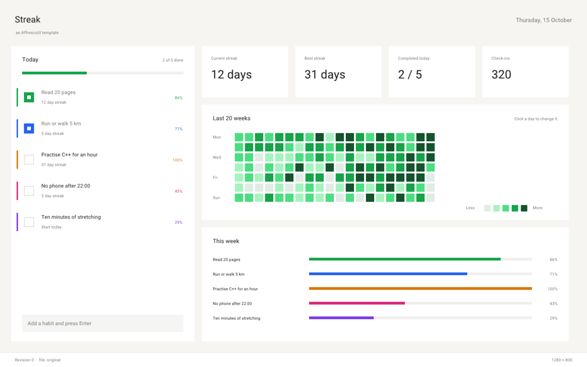<br/><b>Streak</b> · a habit tracker<br/><sub>Daily habits with goals and schedules, scores, charts, a calendar, notes and reminders, all kept on disk. <code>examples/streak/index.screen.json</code></sub></td>
<td valign="top">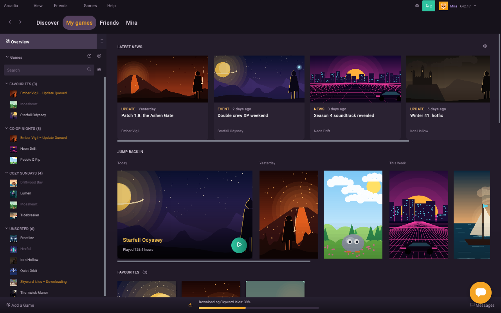<br/><b>Arcadia</b> · a game launcher<br/><sub>A library and a store with carousels, game pages, downloads, a wishlist and a cart. Built by an outsider from the public docs. <code>examples/arcadia/index.screen.json</code></sub></td>
</tr>
<tr>
<td valign="top">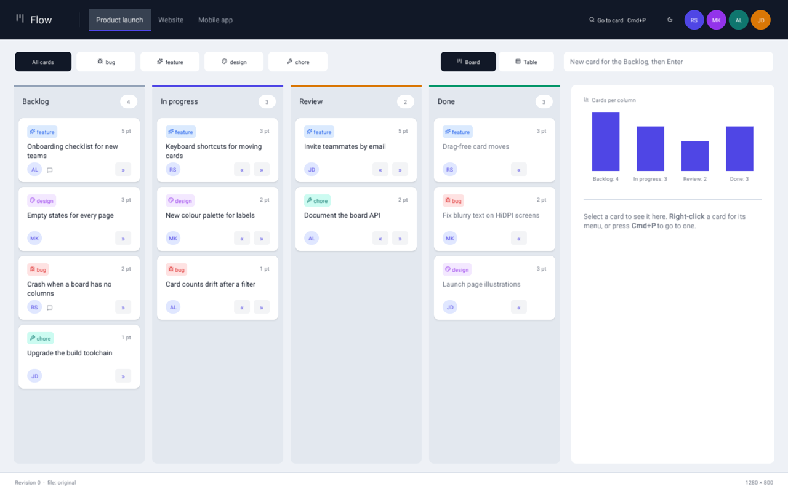<br/><b>Flow</b> · a Kanban board<br/><sub>Boards with swimlanes, a table and a timeline of every card, a card drawer, a burndown, drag and drop with a keyboard alternative, undo and a command palette. The host's default. <code>examples/flow/index.screen.json</code></sub></td>
<td valign="top">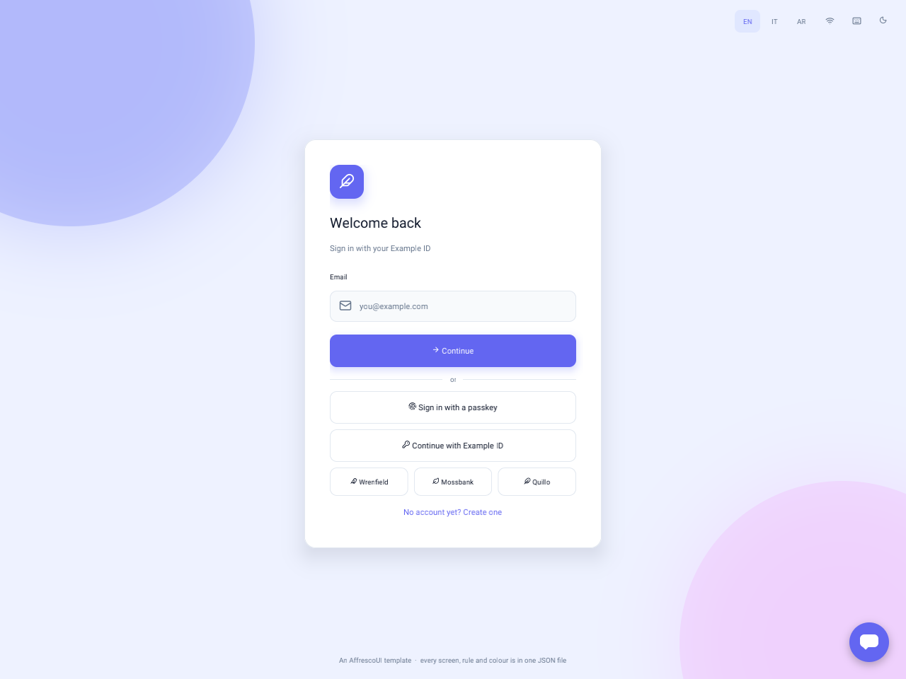<br/><b>Sign in</b> · accounts<br/><sub>Sign in and sign up, two-step codes, a password reset, a sample external provider, an account page and session expiry, all validated in the document. <code>examples/sign-in/index.screen.json</code></sub></td>
</tr>
</table>

Open them from the **Launcher** (`./build/affrescoui_launcher`), or run one with `./build/affrescoui_launcher <file>`.
None has a program of its own: files, the terminal and pixels are the library's. Flow, Haven, Tempo, Streak, Arcadia
and Sign in speak English, Spanish and French.

## Architecture

AffrescoUI renders what it is told to: an application is a folder of documents (and, in a program that embeds the
library, any native code it registers), and the engine knows nothing else about it. It is built in three layers, each
made only of the one below:

- **Apps**: folders of files (screen documents, data, assets) that the Launcher opens, with nothing compiled for them.
- **Themes** (`modules/themes`): the kits' components (toolbars, menus, docks, dialogs) and the themes' design
  tokens, as JSON files built into the library.
- **Engine** (every other module): mechanisms only. It looks a component or token a document doesn't define up in the
  installed kits and themes, and knows none of them by name; a document's own components win over the kits'.

A change travels down a stack of layers, each with one job.

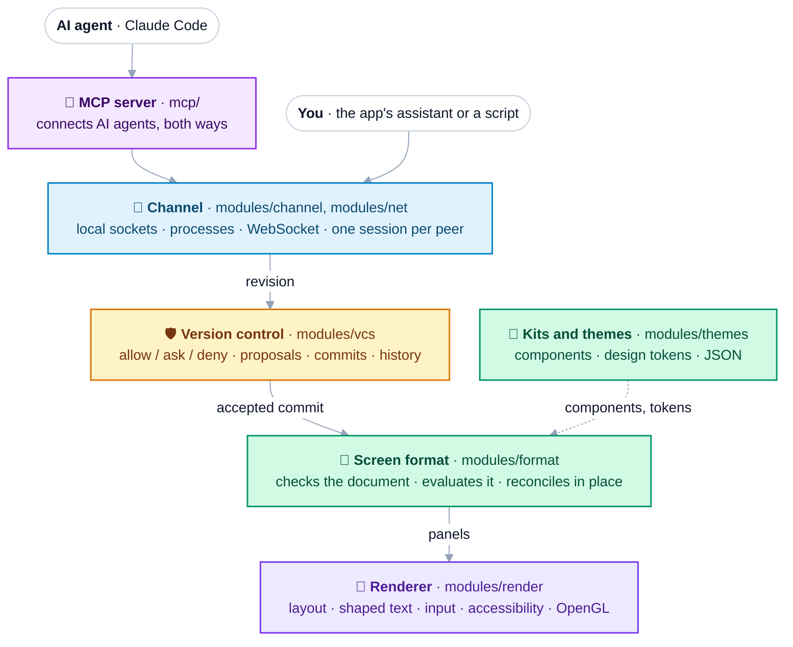

- **One format.** A screen document ([SCREEN_FORMAT.md](SCREEN_FORMAT.md), with a
  [JSON Schema](schema/affrescoui-screen.schema.json)) holds layout, components, themes, state, JS-style
  `{{expressions}}`, events, timers, services and permissions. Behaviour that usually needs code (wiring a button to a
  list, validating a form, filtering, drag and drop, shortcuts, navigation, calls to services) is data, so an agent
  changes it as safely as a colour.
- **Compact for agents.** Edits address nodes by id (`{"set": {"#title/text": "Q4"}}`, stored as JSON Patch) and
  re-reads return only what changed: a typical edit is 24 tokens, a re-read after one commit 29
  ([BENCHMARKS.md](BENCHMARKS.md)).
- **Swappable layers.** Modules talk only through the interfaces in `modules/core`, and `affresco::Screen` plugs them
  together. No public header exposes OpenGL or GLFW, and each module links on its own (`affrescoui::render`,
  `affrescoui::vcs`, ...) or all together (`affrescoui::affrescoui`).
- **Features travel.** A part declares the contribution points and contracts it needs, so one application installs
  another's feature, checked before it lands.

```
modules/core/        the interfaces between modules: Executor, Channel, VersionControl, Services, Network
modules/render/      windows, panels, layout, shaped text, input, accessibility; OpenGL 4.1 core or ES 3.0
modules/format/      the screen format: rules, checker, {{expressions}}, the runtime that reconciles in place
modules/themes/      the kits' components and the themes' design tokens, as JSON built into the library
modules/vcs/         version control: commits, proposals, permissions, history
modules/channel/     peers and the live protocol over local sockets and processes
modules/net/         HTTP(S), server-sent events, WebSocket, remote peers
modules/services/    language servers, local programs and folders the host grants
modules/intelligence/ the providers an app's assistant asks (APIs or a command line), behind the assistant capability
modules/screen/      affresco::Screen, the composition root, and the umbrella header affresco/affresco.hpp
modules/automation/  scenarios: scripted input, expectations, golden images
modules/imaging/     layered images on copy-on-write tiles
modules/scene3d/     3D scenes, glTF 2.0 in and out
modules/export/      panel trees as vector PDF
modules/capi/        the C API, affresco/affresco.h
mcp/                 the MCP server for AI agents
apps/server/         the document server: shared, persistent documents over WebSocket
apps/host/           the stock host, affrescoui_launcher: it opens an app's folder and asks for what the app uses
examples/            the apps (each a folder with an app.json), the Launcher among them, the assistant add-on
web/                 the WebAssembly build
```

The layers, the path of a revision and of an event, and the security boundary: [ARCHITECTURE.md](ARCHITECTURE.md).

## Why it's different

<table>
<tr>
<td width="33%" valign="top">

### 🎨 Truly native
A from-scratch **C++23** engine on **OpenGL 4.1 core or ES 3.0** (WebGL2 in the browser). No browser engine, no web
view. Frames are batched, only what changed is redrawn, and an idle window sleeps.

</td>
<td width="33%" valign="top">

### 📄 Live documents
A whole app in one readable document: layout, components, state, `{{expressions}}`, events, services. Changes are
**compact edits** by node id, atomic, and reconciled **in place**.

</td>
<td width="33%" valign="top">

### 🛡️ Version control built in
Content-addressed commits, proposals as branches with **live preview**, revert and diff; `allow` / `ask` / `deny`
rules and change budgets. An AI can change your app but **can never approve its own changes**.

</td>
</tr>
<tr>
<td valign="top">

### 🤖 Agent-ready
A **two-way MCP server**: requests from the app reach the agent, and its revisions and replies come
back. Works with Claude Code out of the box.

</td>
<td valign="top">

### 🔌 Any number of peers
Clients, agents and scripts connect over local sockets, or over the network through the document server. Identity
comes from the connection, never from what a peer claims.

</td>
<td valign="top">

### 🧩 Changes become plugins
Any run of revisions exports as a **change set**, a small portable file that anyone with the same application can
review and install.

</td>
</tr>
</table>

## How it works

```mermaid
%%{init: {"theme": "base", "flowchart": {"curve": "basis", "nodeSpacing": 28, "rankSpacing": 46, "padding": 14}, "themeVariables": {"fontFamily": "Helvetica, Arial, sans-serif", "fontSize": "14px", "lineColor": "#94A3B8", "primaryTextColor": "#0F172A", "edgeLabelBackground": "#FFFFFF"}}}%%
flowchart LR
    subgraph P["Who changes it"]
        direction TB
        you["<b>You</b><br/>the app's assistant"]
        ai["<b>AI agent</b><br/>Claude Code · MCP"]
        any["<b>Scripts & apps</b><br/>any socket client"]
    end

    subgraph V["Version control"]
        direction TB
        rules{"<b>Permission rules</b><br/>deny · ask · allow"}
        pr["<b>Proposal</b><br/>branch · live preview"]
        no["<b>Rejected</b><br/>nothing changes"]
    end

    subgraph E["Engine"]
        direction TB
        main[("<b>main</b><br/>SHA-256 commits")]
        rt["<b>Runtime</b><br/>reconcile in place"]
        gl["<b>Renderer</b><br/>C++23 · OpenGL"]
    end

    app(["<b>Your running app</b><br/>never restarts"])

    you & ai & any -- "revision" --> rules
    rules -- "allow" --> main
    rules -- "ask" --> pr
    rules -- "deny" --> no
    pr -- "you accept" --> main
    main --> rt --> gl --> app

    classDef peer fill:#FFFFFF,stroke:#CBD5E1,stroke-width:1px,color:#0F172A
    classDef gate fill:#FFFBEB,stroke:#D97706,stroke-width:1.5px,color:#78350F
    classDef wait fill:#FFFFFF,stroke:#D97706,stroke-width:1px,stroke-dasharray:4 3,color:#78350F
    classDef stop fill:#FFFFFF,stroke:#E11D48,stroke-width:1px,color:#9F1239
    classDef core fill:#EEF2FF,stroke:#6366F1,stroke-width:1.5px,color:#1E1B4B
    classDef out fill:#0F172A,stroke:#0F172A,color:#FFFFFF
    class you,ai,any peer
    class rules gate
    class pr wait
    class no stop
    class main,rt,gl core
    class app out
    style P fill:#F8FAFC,stroke:#E2E8F0,color:#64748B
    style V fill:#F8FAFC,stroke:#E2E8F0,color:#64748B
    style E fill:#F8FAFC,stroke:#E2E8F0,color:#64748B
    linkStyle 0,1,2 stroke:#94A3B8
    linkStyle 3 stroke:#16A34A,stroke-width:2px
    linkStyle 4 stroke:#D97706,stroke-width:1.5px
    linkStyle 5 stroke:#E11D48,stroke-width:1.5px
    linkStyle 6 stroke:#16A34A,stroke-width:2px
    linkStyle 7,8,9 stroke:#6366F1,stroke-width:2px
```

1. **Anyone can propose a change.** The host (`affrescoui_launcher`) renders a screen and listens for peers on local
   sockets. You ask through the app's assistant; the AI answers through the provider chosen in the
   Launcher, or an agent connects through the MCP server, which works both ways; any script can connect too. Every change is a **revision** of compact edits.
2. **The permission rules decide:** `deny` refuses, `ask` sends the change to review, `allow` applies it. Rules judge
   what a change *does*, not how it is written. Flow's rules, for example, let the person's own client change anything, ask before
   an agent changes behaviour, and protect the status bar from everyone.
3. **You review proposals.** A proposal is a branch, like a pull request: the agent can refine it while you preview it
   live. Then **Accept**, **Always allow** (don't ask again for that part of the screen) or **Reject** with a reason.
   The modes *accept edits* and *plan* change how much is asked.
4. **Accepted changes become commits on `main`**, with SHA-256 ids, the author and the approver. The runtime updates
   the running app in place, keeping focus and typing, and any commit can be reverted or restored
   ([VERSION_CONTROL.md](VERSION_CONTROL.md)).


## Quick start

```sh
cmake -S . -B build && cmake --build build

./build/affrescoui_launcher                  # the Launcher: every app, your own apps, the AI settings
```

In the Launcher's **Settings**, choose the AI the assistants use: Anthropic, OpenAI, an OpenAI-compatible server
(such as Ollama) or your Claude Code login, and a model. Keys stay in the system's keychain. Every app you open then
has a working assistant, with no MCP. To connect an AI agent through MCP instead ([mcp/README.md](mcp/README.md)):

```sh
claude mcp add affrescoui -- python3 /path/to/AffrescoUI/mcp/affrescoui_mcp.py
claude --dangerously-load-development-channels server:affrescoui   # requests are pushed into the session
```

Open Flow and ask *"add a Blocked column between In progress and In review"* in the board's assistant. Claude
changes the running board and the change comes back as a proposal: **Accept** it and the app updates in place, or
**Always allow** to stop being asked about that part of the screen.

```sh
./build/affrescoui_launcher examples/haven/index.screen.json                # any application, no C++
./build/affrescoui_launcher examples/flow/index.screen.json --mode acceptEdits # agent changes apply unless a rule asks
./build/affrescoui_launcher examples/flow/index.screen.json --plugin my.json   # start with a change set applied
```

Requires CMake 3.25 or later and a C++23 compiler; CMake fetches the pinned dependencies
([cmake/dependencies.json](cmake/dependencies.json)). CI builds and tests it on Linux and Windows and builds it on
macOS, where it is developed; [web/](web/README.md) builds it for the browser. `ctest --test-dir build` runs the unit
tests, every application's scenarios and the rendering check, which compares each frame with a golden image, pixel
for pixel ([tests/render/README.md](tests/render/README.md)).

## Use it in your app

```cpp
#include <affresco/affresco.hpp>

int main() {
	affresco::Application app;
	affresco::Screen screen = affresco::Screen::fromFile("app.screen.json");
	screen.createWindow(app);

	screen.onAction("save", [&](affresco::Panel&) { /* native code, if needed */ });
	screen.listen(app, "/tmp/my-app/agent.sock", "agent"); // optional: let other programs change it live
	return app.run();
}
```

```cmake
find_package(AffrescoUI REQUIRED)   # or add_subdirectory(AffrescoUI) / FetchContent
target_link_libraries(my_app PRIVATE affrescoui::affrescoui)
```

From C or another language, the C API (`affresco/affresco.h`) loads, drives and embeds a screen; `bindings/python`
wraps it.

<details>
<summary><b>Everything the engine does</b></summary>

- **Screen format:** layout (anchors, rows, columns, grids, splits, tabs, scrolling, overlays), styles, components
  with parameters and slots, themes and tokens, fonts, screens and navigation, state, `computed`, `watch`, JS-style
  `{{expressions}}`, `repeat` / `when` / `let` / `check`, two-way `bind`, events with bubbling, commands, menus,
  keybindings and settings, drag and drop, timers, animations, channels, `persist`, includes, strings with ICU plurals
  and locales.
- **Nodes:** labels, text areas, a code editor with declarative languages and syntax trees, diffs, lists, trees and
  virtualised tables, node graphs, timelines, calendars, vector paths, an editable canvas, images and image
  operations, raster layers, 3D scenes, native OpenGL surfaces, colour pickers, gradients and curves, plus a kit of
  desktop and chat components.
- **Live documents:** in-place reconciliation; revisions as compact edits or JSON Patch, atomic, by `#id`; any number
  of peers over local sockets, processes or the network; request and reply relaying; asking the agents from inside
  the app.
- **Version control:** SHA-256 commits, an append-only `main`, proposals as branches with merge commits, log, diff,
  blame, revert, restore, `HEAD~1` names; `allow` / `ask` / `deny` rules judged by effect, modes, grants, budgets,
  reviewers, protected controls, approvals pinned to the version reviewed; change sets; history on disk.
- **Services and network:** language servers and local programs the host allows, folders it grants, HTTP(S),
  server-sent events, WebSocket, sign-in, and a document server that shares documents live.
- **Agents:** a two-way MCP server with minified reads, outlines, single-node reads and changes-only re-reads,
  pictures of the screen, scenarios, leases on parts, and authors set by the connection, never self-declared.
- **Engine:** HarfBuzz shaping and FreeType glyphs with fallbacks, right-to-left text, colour emoji, HiDPI, damage
  redraws, the platform's accessibility API (VoiceOver, Narrator, Orca), headless windows for tests, vector PDF export.
- **Tooling:** the `affrescoui` CLI (run, check, test, render, fmt, migrate, import from A2UI and Adaptive Cards,
  export), scenarios with golden images, a VS Code extension, a C API with a Python binding, a WebAssembly build.

</details>

## Documentation

| Document | What it covers |
|---|---|
| [SCREEN_FORMAT.md](SCREEN_FORMAT.md) | The screen format, node by node |
| [VERSION_CONTROL.md](VERSION_CONTROL.md) | Commits, proposals, permissions and review |
| [ARCHITECTURE.md](ARCHITECTURE.md) | The modules, the path of a revision and of an event, the security boundary |
| [mcp/README.md](mcp/README.md) | The MCP server and its tools |
| [BENCHMARKS.md](BENCHMARKS.md) | Speed, memory and token budgets, with every measurement |
| [ACCESSIBILITY.md](ACCESSIBILITY.md) | What screen readers see and drive, on every platform |
| [SECURITY.md](SECURITY.md) | The trust model, what is protected, and how to report a vulnerability |
| [CHANGELOG.md](CHANGELOG.md) | What changed in each release |

## The story

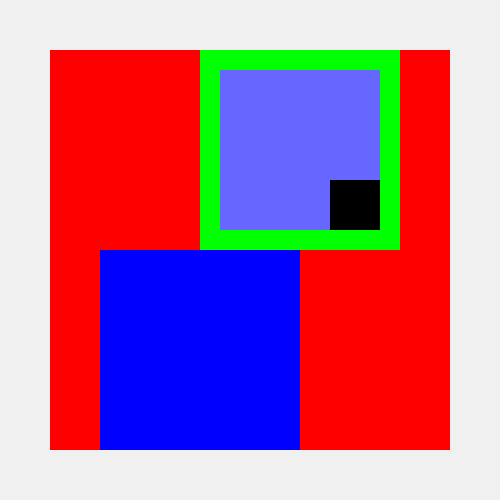

AffrescoUI started in **December 2017** as **sGLGUI**, when I was **16**, as a way to teach myself OpenGL and C++: nested panels,
pixel/percent sizing, anchors and a signal/slot event system, all from scratch. In 2018 I added a text area. It
collected keystrokes but **could never draw them**, and the project stalled. A restart in 2020 rewrote the layout
engine (the image on the right is that demo), then stalled again.

In **2026** I revived it with **Claude Code**. The first goal was a library you could actually use: we ported it to
OpenGL 4.1 core, rewrote it in C++23 and finally rendered text. Then an idea sparked: what if an AI agent could change
a native app *while it runs*, and you approved every change? That took it far beyond the original plan: UIs described
in JSON, live revisions, version control and a two-way MCP bridge for AI agents.

**How it was built.** To be clear about it: all of the 2026 code was written by Claude Code, through agent-driven
development. What I brought is the direction and the architecture. I shaped it over many iterations, trying an idea,
looking at what it did and changing course, until it worked the way I wanted. The git history shows every step.

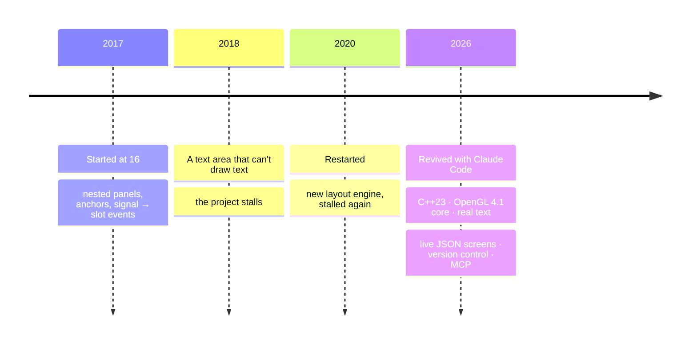

## License

**Apache License 2.0**: free to use, modify and distribute, commercially or not. Anyone who distributes it must pass
on the [NOTICE](NOTICE) file, which credits the author. See [LICENSE](LICENSE) and
[THIRD_PARTY_NOTICES.md](THIRD_PARTY_NOTICES.md).

<div align="center">
<br/>

**Created by [Riccardo Sottini](https://github.com/RiccardoSottini)** · 2017–2026

<sub>If AffrescoUI made you think "wait, an AI can change a native app *while it runs*?", leave a ⭐.</sub>

</div>
