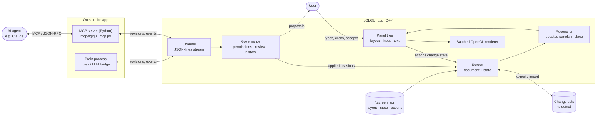
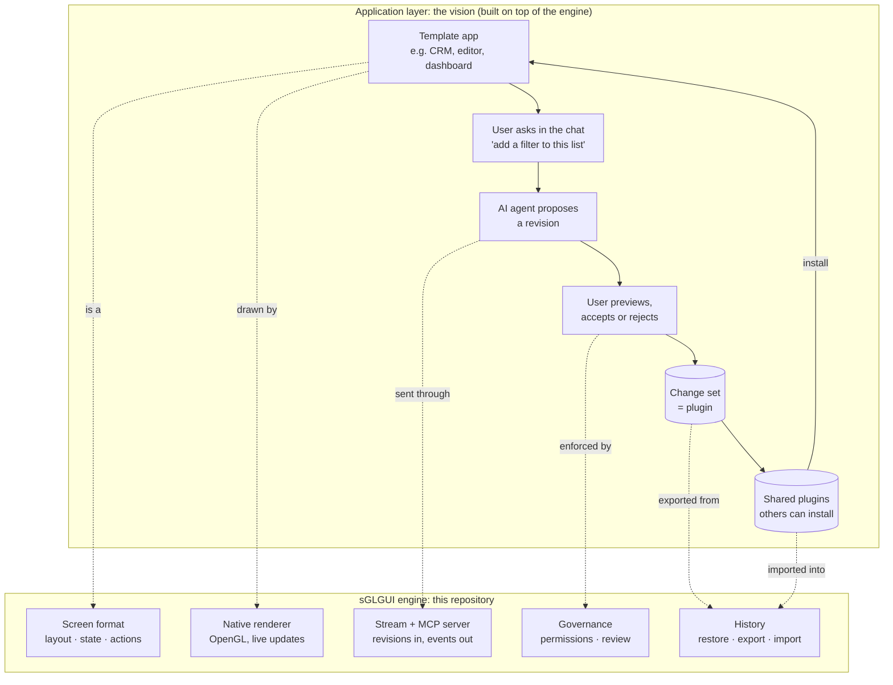

# sGLGUI

A native **rendering engine for AI-driven interfaces**, written from scratch in **C++23** and **OpenGL 4.1 core**.

An application's whole UI, its layout, state and behaviour, is a JSON document that the engine renders natively and
keeps **live**. While the app runs, an AI agent (or any program) can change that document through a stream of
**revisions**. Every change is governed: permissions decide who may change what, the user reviews proposals before
they apply, and the full history can be restored, exported and shared.

Created by Riccardo Sottini. Started in 2017 as a way to learn OpenGL and C++, revived in 2026.

## How it fits together



1. **The screen file** describes the UI: layout, styles, state, bindings and actions ([SCREEN_FORMAT.md](SCREEN_FORMAT.md)).
2. **The engine** builds it into a panel tree, renders it with one batched draw call, and runs the actions when the
   user interacts. When state changes, the reconciler updates only what changed and keeps focus, typing and drags.
3. **The stream:** over a channel, an outside program sends **revisions** (JSON Patch) and receives what the user
   does. It can be the **Python MCP server**, so any MCP agent such as Claude can drive the app, or any "brain" process.
4. **Governance** checks every revision: who sent it, what it touches, and whether the user must approve it first.
   See [GOVERNANCE.md](GOVERNANCE.md).

## The vision
The engine is the foundation for a larger idea, at the **application layer**: a user starts from a rich template
application, then **customises it by talking to it**. "Add a filter to this list", "make the sidebar collapsible",
"show the total in red when it's negative". Each request becomes a reviewed revision of the screen. The result is
stored as a **change set**, a small, portable file that works like a **plugin**: it can be shared, reviewed and
installed by others on the same template.



This repository is the **engine** that makes that possible: rendering, the live document, governance, history,
change sets and the agent interfaces. The application layer (template catalogues, a plugin marketplace) builds on top.

## Try it

```sh
cmake -S . -B build && cmake --build build

./build/chatbot_demo                       # a chat app whose UI and behaviour are a screen file
./build/chatbot_demo --brain "python3 examples/brains/rules_brain.py"
# type "dark mode", "add a counter", "bigger text": each becomes a proposal you preview, accept or reject

./build/screen_viewer examples/assets/screens/sign-in.screen.json   # any screen file, no C++
./build/chatbot_demo --plugin my-changes.json                       # start with a change set applied
```

### With Claude (MCP)
The Python MCP server starts the app and feeds the agent's changes into its stream:

```sh
claude mcp add sglgui -- python3 /path/to/sGLGUI/mcp/sglgui_mcp.py -- /path/to/sGLGUI/build/chatbot_demo
```

Then ask Claude to change the running app. Its changes arrive as proposals for you to review in the app.
See [mcp/README.md](mcp/README.md).

## Native performance
Measured on an Apple M4 Pro (release build), chat with thousands of messages, each a wrapped text bubble:

| Messages on screen | Full frame (draw + GPU) | Keystroke → UI updated | Revision applied |
|---|---|---|---|
| 200 | 0.47 ms | 1.1 ms | 1.4 ms |
| 1,000 | 0.45 ms | 4.3 ms | 4.5 ms |
| 3,000 | 0.47 ms | 12.3 ms | 12.4 ms |

- **One draw call** per frame per font: rectangles and text share a shader and a texture.
- **No work when idle:** frames are drawn only when something changed; 0% CPU while waiting for input.
- **16-byte vertices**, a grow-only index buffer, buffer orphaning, glyph atlases uploaded once.
- **Small:** the example app is a ~1.1 MB binary. No browser engine, no web view.

## Features
- **Screen format:** layout, styles, named colors, fonts, templates, state, `{{bindings}}`, `$` operators,
  `repeat` / `when`, two-way `bind`, actions with conditions and loops, custom native types
- **Live documents:** in-place reconciliation, revisions (JSON Patch, atomic, `#id` paths), a JSON-lines channel
- **Governance:** per-author policies (allow / review / deny), locked parts, protected controls, proposals with
  live preview, accept/reject, an audit history, restore, change sets (plugins)
- **Agents:** a Python MCP server, a brain-process channel; authors are assigned by the channel, never self-declared
- **UI engine:** nested panels in pixels or percentages, anchors, clipping, stacks, typed input events, mouse
  capture, hover, cursors, TrueType text with wrap and fit-to-text, a text input with caret, HiDPI

## Using the library

```cpp
#include <sgl/sgl.hpp>

int main() {
	sgl::Application app;
	sgl::Screen screen = sgl::Screen::fromFile("app.screen.json");
	sgl::Window& window = screen.createWindow(app);

	screen.onAction("save", [&](sgl::Panel&) { /* native code, if needed */ });
	return app.run();
}
```

```cmake
add_subdirectory(sGLGUI)   # or FetchContent
target_link_libraries(my_app PRIVATE sglgui::sglgui)
```

Requires CMake ≥ 3.25 and a C++23 compiler. GLFW and nlohmann/json are downloaded automatically.

## Project layout
```
include/sgl/      public headers (no OpenGL or GLFW headers exposed)
src/              implementation: windows, panels, text, screens, channels
src/screen/       screen-format internals (expressions)
src/gl/           all OpenGL code: context, RAII objects, shaders, batched renderer
src/detail/       internal helpers (UTF-8, PPM images)
mcp/              the Python MCP server
schema/           JSON Schema of the screen format
examples/         example apps, screens, fonts and a sample brain
external/         vendored glad (OpenGL loader) and stb_truetype
```

## License
**Apache License 2.0**: free to use, modify and distribute, commercially or not. Anyone who distributes it must pass
on the [NOTICE](NOTICE) file, which credits the author. Copyright (c) 2017-2026 Riccardo Sottini. See
[LICENSE](LICENSE) and [THIRD_PARTY_NOTICES.md](THIRD_PARTY_NOTICES.md).
