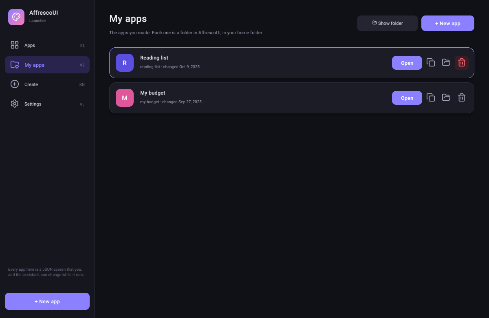

# Examples

One folder per application, holding the same app twice: `json/` and `lisp/`, each complete with its `app.json`, screens,
scenarios and assets, and a short README beside them. What more than one of them uses is in `shared/`. None of this is part of the library; each uses only its public API.

```
examples/
├── templates.json      the shipped templates: each one's name and folder (read by the tests, the tools, the web
│                       build and the release archive)
├── shared/             addons/, components/, fonts/, host/ (the host's own screens), languages/
│
├── launcher/           template "launcher": the apps, your own, creating one (what the host opens without a file)
├── flow/               template "kanban": a Kanban board
├── haven/              template "smart-home": a smart-home dashboard, images/
├── tempo/              template "music-player": a music player, images/
├── streak/             template "habit-tracker": a habit tracker
├── sign-in/            template "sign-in": sign in, create an account, signed in
├── code-editor/        template "code-editor": Quaderno, a code editor
├── calamaio/           template "calamaio": Calamaio, a text editor configured by its document
│
├── arcadia/            a game launcher built only from the public docs and tools, covers/, its end-to-end test
├── forge/              a demo IDE run by the host: features/, catalog/, its scenarios
├── tempera/            an image editor on modules/imaging, parts/, run by the host
├── sinopia/            slides and vector documents, parts/, run by the host
├── modello/            a 3D modeller and scene editor on modules/scene3d, run by the host
└── orrery/             a planetarium, run by the host
```

The stock host is in `apps/host` and the document server in `apps/server`; a screen inside a program's own OpenGL
scene is `modules/capi/example`.

**JSON or Lisp.** `<app>/json/` is the source and `<app>/lisp/` is written from it, so make a change in `json/` and run
`python3 tools/notation/lisp_examples.py` (the test `cli_lisp_examples` fails if you forget). In `lisp/`, every document
an app loads is a `.lisp` file: its screens, what they include, its themes, models and seed data. The files with a reader
of their own stay JSON (`app.json`, scenarios, policies, adapters, a package's manifest and catalogue), and the assets are
copied so the folder runs alone. `shared/` keeps a `.lisp` file beside each JSON one it serves. Both versions load as
the same document (`tests/unit/lisp_examples.cpp`), and each keeps its own data, permissions and history. The Launcher's
**Settings → Example apps** chooses which one opens; `./build/affrescoui_launcher examples/flow/lisp` opens one directly.

A template is a screen document with no C++ of its own: any of them runs in the host.

```sh
./build/affrescoui_launcher examples/haven/json/index.screen.json
./build/affrescoui test examples/haven/json/index.scenarios.json
```

A screen's relative paths (its `include`s, fonts, images) are read from its own folder, so the templates name their
fonts `../shared/fonts/...`. A new template gets a folder and a line in `templates.json`, which the scenarios test,
the tools, the web build and the release archive read (CI's scenarios step names the folders too).

The programs find this folder through `apps/shared/Assets.hpp`: in a build, `examples/` in the source tree; in a release
(`tools/release`), `assets/` next to the program, which has the template folders and `shared/` laid out the same way,
without the C++ sources.

## Gallery

Every application, its first frame and one scene, drawn offscreen by `python3 tools/media/capture.py` from the list in
[`tools/media/gallery.json`](../tools/media/gallery.json) (CI opens and draws each one: `tests/smoke/first_frames.py`).
Run each from the repository's root after building. Every application includes the assistant add-on
([`shared/addons/assistant`](shared/addons/assistant/README.md)): the round button in its bottom right corner opens a
chat with the connected agents.

| Application | Pictures | Run | What it shows |
|---|---|---|---|
| [Launcher](launcher/README.md), the apps' home |   | `./build/affrescoui_launcher` | the examples as cards with search and categories, your apps (open, duplicate, delete), creating one blank or from an example with a first request for its assistant; `fs` services on granted folders and the host's app-programs grant, no C++ |
| [Flow](flow/README.md), a Kanban board |   | `./build/affrescoui_launcher examples/flow/json/index.screen.json` | `include`d parts, drag and drop with a keyboard alternative, a virtualised table, the timeline, the command palette, settings, three languages |
| [Haven](haven/README.md), a smart-home dashboard |   | `./build/affrescoui_launcher examples/haven/json/index.screen.json` | a canvas floor plan, the graph node editor, the timeline, charts, the colour picker, an `every` timer simulating the devices |
| [Tempo](tempo/README.md), a music player |   | `./build/affrescoui_launcher examples/tempo/json/index.screen.json` | a 3,000-song virtualised table, grids, a GPU surface visualiser, the `curves` equaliser, a mini player |
| [Streak](streak/README.md), a habit tracker |   | `./build/affrescoui_launcher examples/streak/json/index.screen.json` | `persist`, schedules and goals, a year heatmap and charts, reminders as toasts, a document-server connection |
| [Sign in](sign-in/README.md) |   | `./build/affrescoui_launcher examples/sign-in/json/index.screen.json` | `secret` fields, `codeInput`, `check` rules, `screens` and `navigate`, a made-up OAuth provider, ICU plurals |
| [Quaderno](code-editor/README.md), a code editor |   | `./build/affrescoui_launcher examples/code-editor/json/index.screen.json` | a menu bar, an explorer tree, editor tabs with the host's `code` type, quick open, problems, a terminal |
| [Arcadia](arcadia/README.md), a game launcher |   | `./build/affrescoui_launcher examples/arcadia/json/index.screen.json` | a `carousel`, `quickPick` with two providers, key chords, declared settings; built only from the public docs |
| [Forge](forge/README.md), a demo IDE |   | `./build/affrescoui_launcher examples/forge/json/app.json [--folder DIR]` | no C++: files, search, source control, a terminal, language servers and a debugger on the library's services, a workbench of panels |
| [Tempera](tempera/README.md), an image editor |   | `./build/affrescoui_launcher examples/tempera/json/index.screen.json` | a `surface` canvas the host composites, layers, masks and filters with a live preview, agents limited to proposals |
| [Sinopia](sinopia/README.md), a presentation editor |   | `./build/affrescoui_launcher examples/sinopia/json/index.screen.json` | a ribbon of tabs and galleries, slide thumbnails in sections, a `canvas` editor, speaker notes, a slide show with a presenter view and an audience window, saving, opening and PDF export |
| [Modello](modello/README.md), a 3D modeller |   | `./build/affrescoui_launcher examples/modello/json/index.screen.json` | a PBR viewport (`scene3d`), gizmos, glTF import and export, every scene edit a revision |
| [Orrery](orrery/README.md), a planetarium |   | `./build/affrescoui_launcher examples/orrery/json/index.screen.json` | a `scene` node bound to computed values, a sky chart on a `canvas`, a `graph`, a `timeline`, Sinopia's slide sorter installed through an adapter; built only from the public docs |

The technical demos:

- [host](host/README.md): `affrescoui_launcher`, the stock host that runs any screen, with its sockets for the person's client and agents.
- [server](server/README.md): `affrescoui_server`, the document server: history on disk, tokens, live sharing.
- [embed](embed/README.md): `affrescoui_embed`, a screen inside a host's own OpenGL scene, through the C API.
- [surfaces](surfaces/README.md): `affrescoui_surfaces`, the host's own OpenGL in `surface` nodes.
- [shared](shared/README.md): what more than one example uses (assets, the `code` type, fonts, chart components).
